<div align="center">


# PactPal

### AI that seals the deal.

Turn a deal agreed in chat into a signed record tied to PayPal invoices.<br>
Every step is logged so nobody can quietly edit it, and if the buyer disputes, the evidence is ready.

<p>
<a href="LICENSE"></a>   <br>
 <br>
<a href="https://github.com/sushantpatil2899/paypal-hackathon/actions/workflows/ci.yml"></a>  <br>
<a href="#running-on-render"></a> <a href="#sponsor-tools"></a>
</p>

**[Live app](https://pact-pal.app)** · **[Help](https://help.pact-pal.app)** · **[Diagrams](https://help.pact-pal.app/diagrams.html)** · **[Try it](#try-it)** · **[Demo video](#demo-video)**

<a href="https://pact-pal.app">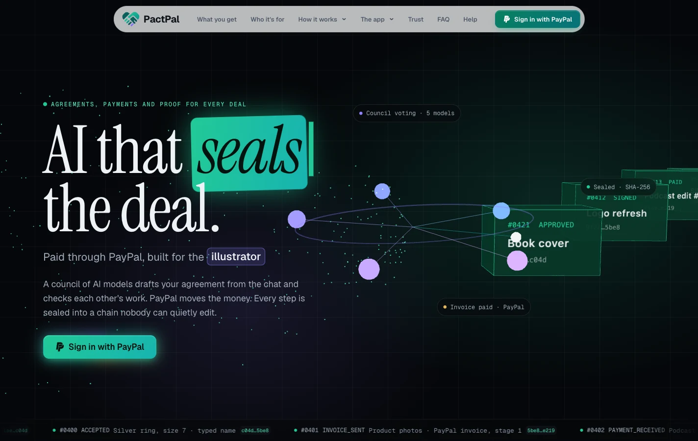</a>

</div>

<!-- TODO(video): replace with the YouTube thumbnail and link once the demo video is published. -->

### Demo video

> Coming soon (under 3 minutes).

Built for the [Build What's Next with PayPal and AI](https://paypalaihackathon.devpost.com/) hackathon. Runs on PayPal's sandbox: no real money moves.

---

**Reading this README.** It starts with why PactPal exists, then shows what it does, then goes into how it is built. Jump to any part:

- **Why:** [The problem](#the-problem) · [What PactPal is](#what-pactpal-is) · [Who it's for](#who-its-for)
- **What:** [How it works](#how-it-works) · [Features](#features) · [Against the judging criteria](#against-the-judging-criteria)
- **How:** [PayPal integration](#paypal-integration) · [AI](#ai) · [AI assistants (MCP)](#ai-assistants-mcp) · [Disputes](#disputes) · [The evidence log](#the-evidence-log) · [Architecture](#architecture) · [Running on Render](#running-on-render) · [Sponsor tools](#sponsor-tools)
- **Use it:** [Try it](#try-it) · [Run it locally](#run-it-locally) · [Quality](#quality) · [Scope and limits](#scope-and-limits) · [Docs](#docs)

## The problem

Freelancers and small sellers paid through PayPal keep losing disputes they should win.

PayPal knows money moved. It does not know what was agreed, what was delivered, or whether the buyer accepted it. That proof lives in chats, emails and screenshots, and the seller pulls it together only after a dispute opens, with a deadline running.

PayPal's own rules say what is missing. For digital goods and services, proof of delivery means:

> "a system of record showing the date the item was sent and that it was either: Electronically sent to the recipient … or Received or accessed by the recipient."
>
> [PayPal's Seller Protection Program (US)](https://www.paypal.com/us/legalhub/paypal/seller-protection), updated 26 Jan 2026

The same page excludes a buyer saying "the item you sent isn't what was ordered". Most small sellers have no such system of record.

Sellers have said the same thing for over a decade:

<table>
<tr>
<td valign="top" width="50%">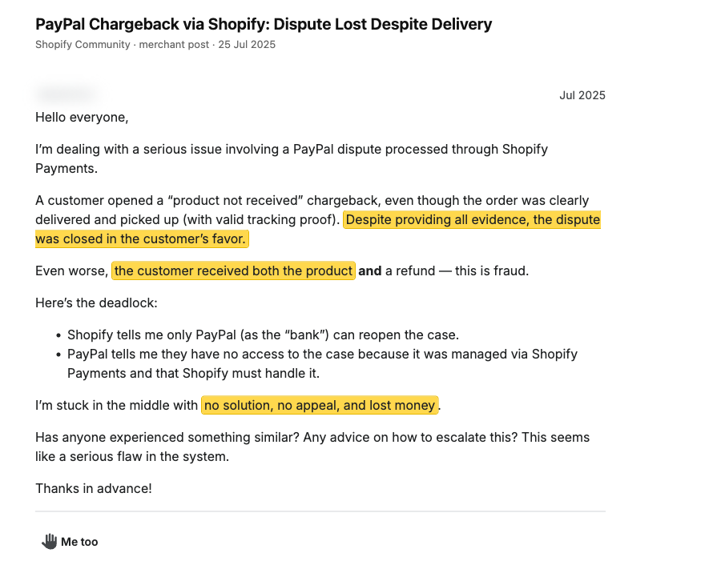</td>
<td valign="top" width="50%">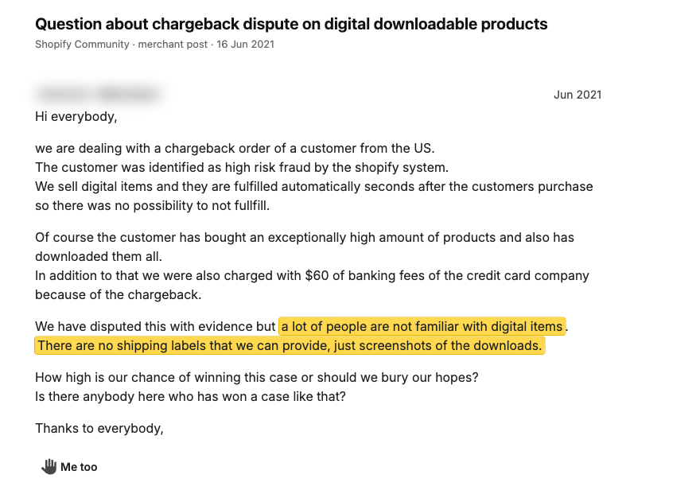</td>
</tr>
<tr>
<td valign="top" width="50%">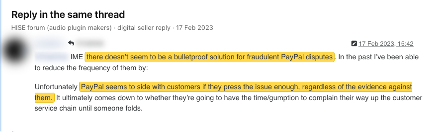</td>
<td valign="top" width="50%">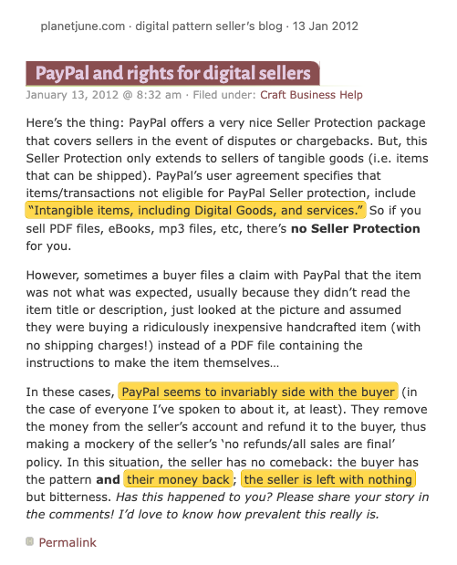</td>
</tr>
</table>

Buyers lose too. A 2026 buyer wrote that PayPal decided a service "was delivered" based on the seller's own records. Neither side had a record they both agreed to.

The size of it:

- **About 45%** of retailer chargebacks are fraud, first-party or third-party. Chargebacks are expected to reach **324 million a year by 2028** ([Mastercard, 2025 State of Chargebacks](https://www.mastercard.com/sea/en/news-and-trends/Insights/2025/what-s-the-true-cost-of-a-chargeback-in-2025.html)).
- **71%** of freelancers struggle to get paid at least once in their career ([Freelancers Union](https://blog.freelancersunion.org/2015/12/10/costs-nonpayment/)).
- PayPal has **42,422 reviews on Trustpilot, 88% of them one star** (checked 11 Nov 2026).

All posts, figures and sources: [docs/problem-evidence.md](docs/problem-evidence.md). Names in every screenshot are blurred.

## What PactPal is

A deal space for one seller and one buyer that records the deal **while it happens**, not after a dispute. Two things carry it: **PayPal** and **AI**. Neither would work alone.

### PayPal: the money and the verdict

- PayPal is where the buyer pays and where a dispute is decided. PactPal replaces neither. It builds the record around them.
- Every agreed payment step becomes a **PayPal invoice** with the agreement's fingerprint in its note. A signed **PayPal webhook** marks it paid and ties the PayPal transaction to the deal.
- Sellers sign in with **Log in with PayPal** and link their own PayPal app.
- When a buyer disputes, PactPal answers through PayPal's **Disputes API**: evidence, an offer, acceptance or an appeal.
- PayPal's rules ask sellers of digital goods and services for "a system of record". PactPal is that record, built on PayPal's own invoices and disputes.

### AI: from a messy chat to a record PayPal can use

- Deals are agreed in chat, in loose words. AI turns the chat into a clear agreement and timeline, citing the chat line behind every term.
- During the deal, AI labels new buyer requests (in scope, an extra revision, or new work), answers buyer questions from the agreement, and checks files before delivery.
- In a dispute, AI compares each line of the buyer's claim with the agreement and the log, and writes a neutral summary for PayPal.
- AI drafts and checks. It never creates evidence, and the seller confirms everything before it goes anywhere.

### Why they need each other

Without AI, the seller would have to write a precise agreement by hand, and most don't. That is why they lose. Without PayPal, the agreement would be a document with no money attached and nowhere to be judged. Together, the chat becomes terms, the terms become PayPal invoices, the invoices and deliveries become evidence, and the evidence answers a PayPal dispute.

### Why a council of five AI models, not one

Agreements and dispute answers are drafted by **five models from five families** (Google, Alibaba, OpenAI, Mistral and NVIDIA) that check and rank each other. [How the vote works](#ai).

1. **It catches wrong values.** One model sometimes states what the chat never said, like a due date from "by Friday". The other models rank that draft down. In one test run, Mistral alone made 4 wrong values in 11 chats; the council's pick made none.
2. **Different blind spots.** Models from different families rarely make the same mistake on the same line.
3. **It is harder to trick.** A line in a pasted chat that tries to give the AI orders has to fool several different models, then win their vote. Since lines that give orders are hidden from the models, no council pick has been compromised in our attack tests.
4. **It is neutral by design.** Drafts are ranked without their authors' names, and a model's vote for its own draft is ignored. A dispute summary has to be fair to both sides.
5. **It knows when it is unsure.** When the models disagree, the agreement score drops and the draft is flagged for the seller to look closer. A single model gives no such signal.
6. **Anyone can inspect it.** The seller sees every model's draft, which ones were thrown out and why, and how the votes went.
7. **No single vendor.** If one model gets worse, changes or goes down, the council keeps working.

A simple fallback chain would cover outages, but none of the other six. In three test runs on 11 chats with known right answers, the council's pick beat the average single model's draft every time: **0.92 vs 0.89, 0.98 vs 0.91 and 0.90 vs 0.87**. It costs about 8 times the tokens and over a minute per draft, so it is used where the stakes are high: agreements and disputes. Quick tasks like buyer questions use one model. These are chats we wrote, one run each, so read them as a tendency. Details: [docs/spike-results.md](docs/spike-results.md#drafting-evals-single-models-against-the-council-sub-phase-3g-1-november-2026).

PactPal never holds money, never gives legal advice, and never predicts an outcome.

## Who it's for

| Who                                                          | What they get                                                                                                                        |
| ------------------------------------------------------------ | ------------------------------------------------------------------------------------------------------------------------------------ |
| **Seller**: freelancer, artist, creator, small online seller | A clear agreement, a PayPal invoice per stage, tracked deliveries, a records score, and a ready packet when a dispute opens          |
| **Buyer**                                                    | One link by email, no account needed. A one-page agreement to sign, answers from the agreement, and approve or ask-for-changes pages |
| **AI assistants**                                            | An MCP server to read deals and prepare work. Sending anything needs the seller's one-time code                                      |

## How it works

<picture>
  <source media="(prefers-color-scheme: dark)" srcset="docs/images/deal-journey-dark.svg">
  
</picture>

**[Open the interactive version](https://help.pact-pal.app/diagrams/deal-journey.html)**

1. **Agree.** Seller and buyer talk in the deal's live chat. Every message is logged with a fingerprint and the server's time.
2. **Draft.** A council of five AI models drafts the agreement and timeline from the chat. Every term cites its chat line, or stays blank.
3. **Sign.** The buyer gets one page with every key term, types their name and signs. Both get a receipt PDF with fingerprints.
4. **Pay.** Each payment step becomes a PayPal invoice. A signed PayPal webhook marks it paid.
5. **Deliver.** Files go through a unique link. Opens and downloads are logged with time, IP address and file fingerprint.
6. **Approve.** The buyer approves or asks for changes, counted against the agreed revisions.
7. **Dispute.** PactPal finds the dispute within 5 minutes, compares the claim with the record, builds the packet, and sends it after the seller confirms.
8. **Appeal.** If the decision goes against the seller, PactPal checks for evidence PayPal has not seen yet, and says plainly if there is none.

## Features

**Deal space**

- One page per deal for both sides, with Chat, Agreement, Timeline, Files and Log tabs
- Live chat with typing, online and "seen" marks; every message is evidence
- Paste a chat or email, upload files, or forward an email to start a deal
- Agreement versions: "Update from the latest chat" drafts the next version from new messages only and shows what changed
- A timeline of every agreed step (references, sketches, reviews, payments, deliveries), each with who does it and when
- Reminders by email and in the chat when a step is due or late
- Change orders when the work changes after signing

**Buyers**

- No account: one emailed link, with an option to sign in with PayPal later
- A one-page agreement, a typed-name signature and a receipt PDF
- Questions answered from the agreement only, with citations, or passed to the seller

**Payments and delivery**

- A PayPal invoice for each payment step, with the agreement's fingerprint in the invoice note
- Payments matched to the deal by signed PayPal webhooks
- Tracked delivery links, approvals and revision limits
- An AI check before delivery: does the file match the agreed lines?
- Product listings read through Channel3: the buyer signs the listing's facts and photos with the rest

**Evidence and disputes**

- A hash-chained, append-only evidence log with a **Check this log** button
- A records score from 0 to 100 that lists what helps and what is missing. It never predicts an outcome
- Disputes found every 5 minutes, matched to their deal, with the deadline and the actions PayPal allows
- Claim vs record: each line of the buyer's claim tied to a term or log entry, or marked "no record covers this"
- An evidence packet PDF: cover sheet, claim vs record, neutral summary, timeline, exhibits, fingerprint list and how to check it
- Answer, make an offer, accept, or appeal, always after the seller confirms
- An appeal check that compares what was sent to PayPal with what else the log holds

**AI**

- A council of five models from five families for every high-stakes draft
- A message watcher that labels new buyer requests as in scope, an extra revision, or new work, with a drafted reply
- A category check: what is really being sold vs. what the seller picked
- Vague words flagged with measurable rewrites

**For AI assistants**

- An MCP server at `/mcp` with 11 tools, a per-seller agent key and 30 drafts a day
- Approval with a one-time code for anything sent to PayPal

**Dashboard and help**

- A dashboard of every deal with records score, next action and deadlines (AG Grid, AG Studio charts)
- Timeline and deadlines as a Gantt chart (Bryntum)
- Branded emails from editable templates
- A help site with 20 pages, including [the diagrams](https://help.pact-pal.app/diagrams.html)
- Retention rules: deals are removed 210 days after their last activity

## Against the judging criteria

Where PactPal stands on each of the hackathon's five judging criteria:

| Criterion                        | Where PactPal stands                                                                                                                                                                                                                                                                              |
| -------------------------------- | ------------------------------------------------------------------------------------------------------------------------------------------------------------------------------------------------------------------------------------------------------------------------------------------------- |
| **Technological implementation** | Six PayPal capabilities working together: invoices, disputes, signed webhooks, sign-in, seller apps, and MCP with REST fallback. A five-model AI council with citations checked in code. An MCP server of its own. See [PayPal](#paypal-integration), [AI](#ai) and [Architecture](#architecture) |
| **Design**                       | One finished product from the first chat to the appeal, for the seller, the buyer and their AI assistants, with a help site and branded emails                                                                                                                                                    |
| **Potential impact**             | A real problem, with sourced figures and sellers' own words ([the problem](#the-problem)), and a fix that gives sellers the "system of record" PayPal's own rules ask for                                                                                                                         |
| **Innovation**                   | The evidence is built during the deal and signed by both sides, not gathered after a dispute. AI drafts, a council checks, and AI never creates evidence                                                                                                                                          |
| **Presentation**                 | A demo video (coming soon), this README, and [interactive diagrams](https://help.pact-pal.app/diagrams.html)                                                                                                                                                                                      |

PactPal is built so that PayPal and AI depend on each other: AI writes the agreement behind every PayPal invoice, and answers PayPal disputes from the record it kept. It also opens commerce to AI agents without handing them the keys. A seller's assistant can read deals, draft them and build evidence over MCP, but nothing reaches PayPal until the seller gives it a one-time code. It is aimed at the people who lose the most today: freelancers and small sellers who lose disputes they should win. And it runs on Render end to end, from one Blueprint, with Workflows running each AI model as its own task so a slow model never holds up a council.

**Tools used, and how**

| Tool                                      | How PactPal uses it                                                                         |
| ----------------------------------------- | ------------------------------------------------------------------------------------------- |
| PayPal Invoicing v2                       | One invoice per agreed payment step                                                         |
| PayPal Disputes v1                        | List and read disputes; provide evidence, make offers, accept claims, appeal, send messages |
| PayPal Webhooks                           | Payment notifications, signature-checked                                                    |
| Log in with PayPal                        | Seller sign-in, and optional buyer sign-in                                                  |
| PayPal MCP server                         | Tried first for every call, with automatic REST fallback                                    |
| Gemini 3.6 Flash (Google)                 | Council member; also reads images for the delivery check                                    |
| Qwen 3.8 27B (Alibaba, via Groq)          | Council member; also reads images                                                           |
| GPT-OSS 120B (OpenAI, via Groq)           | Council member                                                                              |
| Ministral 14B (Mistral)                   | Council member                                                                              |
| Nemotron 3 Ultra (NVIDIA, via OpenRouter) | Council member                                                                              |
| Render                                    | Hosting, Workflows, Cron Jobs, Postgres, Key Value, Static Site                             |
| Channel3                                  | Reads product listing pages for goods and digital products                                  |
| AG Grid, AG Studio                        | The deals dashboard and its charts                                                          |
| Bryntum                                   | The timeline and deadlines Gantt chart                                                      |
| Resend                                    | Sending emails, and receiving forwarded emails                                              |

## PayPal integration

| PayPal capability  | Used for                                                                  | Code                                                              |
| ------------------ | ------------------------------------------------------------------------- | ----------------------------------------------------------------- |
| Invoicing v2       | An invoice per payment step, with the agreement fingerprint in the note   | [`invoices.ts`](packages/paypal/src/invoices.ts)                  |
| Disputes v1        | Read disputes; provide evidence, offer, accept, appeal, message           | [`disputes.ts`](packages/paypal/src/disputes.ts)                  |
| Webhooks           | `INVOICING.INVOICE.PAID` and more, verified with PayPal's signature check | [`paypal-webhook.ts`](apps/server/src/webhooks/paypal-webhook.ts) |
| Log in with PayPal | Sign-in through OpenID Connect                                            | [`login.ts`](packages/paypal/src/login.ts)                        |
| PayPal MCP server  | Every call tries MCP first and falls back to REST                         | [`fallback.ts`](packages/paypal/src/fallback.ts)                  |
| Seller apps        | Each seller links their own PayPal app; secrets are encrypted at rest     | [`seller-app.ts`](packages/paypal/src/seller-app.ts)              |

**A note on MCP.** PayPal's hosted sandbox MCP server lists its tools, but tool calls failed in our tests in October 2026 with `PAYPAL_API_SETUP_ERROR`. PactPal falls back to REST automatically, so every live call is currently served over REST. `pnpm sandbox:check` shows when MCP works again. Details: [docs/sandbox-notes.md](docs/sandbox-notes.md#mcp-and-rest).

## AI

<picture>
  <source media="(prefers-color-scheme: dark)" srcset="docs/images/ai-council-dark.svg">
  
</picture>

**[Open the interactive version](https://help.pact-pal.app/diagrams/ai-council.html)**

High-stakes drafts go to a **council** of five models from five families:

1. Each model drafts the whole answer alone, citing a source line for every term.
2. Code checks every citation. A draft that cites a line that is not there is thrown out.
3. The remaining drafts are shown without their authors. Every model ranks the others; its own vote is ignored.
4. A Borda count picks one whole draft. Drafts are never stitched together.
5. Low agreement flags the draft for the seller.

Each model call runs as its own Render Workflow task, so a slow or failing model never holds up the others. The seller can open the council's record: who answered, who was thrown out and why, and how the votes went.

| AI task                                           | When            | Engine           |
| ------------------------------------------------- | --------------- | ---------------- |
| Agreement, timeline, category check, vague words  | Drafting        | Council          |
| Claim vs record                                   | Dispute         | Council          |
| Neutral packet summary, reply                     | Dispute         | Council          |
| Appeal statement                                  | Appeal          | Council          |
| Buyer questions, answered from the agreement only | Before signing  | One model        |
| Message watcher                                   | During the deal | One model        |
| Pre-delivery file check                           | Before delivery | One vision model |

**Guardrails**

- Citations or blank. Code checks every citation.
- AI never creates evidence, times, approvals or statements.
- Pasted chats are untrusted. Lines that try to give the AI orders are hidden from it.
- Nothing goes to a buyer or to PayPal until the seller confirms.
- No outcome promises, no legal conclusions.
- `pnpm eval:injection` runs a prompt-injection test set. `pnpm eval:scope` scores each model and the council against known right answers.

More: [How the AI drafts](docs/help/ai-council.md) · [Product spec](docs/product.md#ai-roles)

## AI assistants (MCP)

<picture>
  <source media="(prefers-color-scheme: dark)" srcset="docs/images/agent-approval-dark.svg">
  
</picture>

**[Open the interactive version](https://help.pact-pal.app/diagrams/agent-approval.html)**

PactPal is also an MCP server. The seller makes an agent key on the home page, then adds the server to Claude Code, Claude Desktop, Cursor or any MCP client:

```bash
claude mcp add --transport http pactpal https://pact-pal.app/mcp --header "Authorization: Bearer ppk_..."
```

| Tool                                            | What it does                                                                |
| ----------------------------------------------- | --------------------------------------------------------------------------- |
| `list_deals`, `get_deal`                        | Deals: terms, timeline, records score, payment stages                       |
| `list_disputes`, `get_dispute`                  | Disputes: reason, amount, deadline, allowed actions                         |
| `create_deal_from_text`                         | A draft deal from pasted text (30 a day)                                    |
| `draft_evidence_packet`                         | Builds a packet; nothing goes to PayPal                                     |
| `request_send_invoice`, `request_send_evidence` | Asks the seller; waits in the app with its exact wording                    |
| `confirm_action`                                | Runs an approved request with the seller's one-time code (10 minutes, once) |
| `get_request`                                   | Where a request stands                                                      |
| `lookup_listing`                                | Reads a product listing through Channel3                                    |

There is no tool to sign, accept, act for a buyer, make offers, send messages or appeal. Every request and action is logged with the key's last 4 characters. More: [Connect your AI agent](docs/help/ai-agents.md).

## Disputes

<picture>
  <source media="(prefers-color-scheme: dark)" srcset="docs/images/dispute-answer-dark.svg">
  
</picture>

**[Open the interactive version](https://help.pact-pal.app/diagrams/dispute-answer.html)**

PayPal sends no dispute webhooks to the app, so a Render Cron Job starts a check every 5 minutes. New disputes are matched to their deal by invoice and transaction ids, logged, and emailed to the seller with the deadline. The packet is built from the log alone, and goes to PayPal only after the seller confirms. More: [When a buyer disputes](docs/help/disputes.md).

## The evidence log

<picture>
  <source media="(prefers-color-scheme: dark)" srcset="docs/images/evidence-log-dark.svg">
  
</picture>

**[Open the interactive version](https://help.pact-pal.app/diagrams/evidence-log.html)**

- Each entry stores its type, who acted, the server time, a payload fingerprint, the previous entry's fingerprint and its own.
- Editing, backdating or deleting an entry breaks the chain at that entry.
- Postgres triggers refuse updates and deletes on the log tables.
- Corrections are new entries. Nothing is edited.
- **Check this log** walks the chain and shows the first broken entry, if any. Every packet explains how to repeat the check.

The log has 60 event types. More: [The evidence log](docs/help/evidence-log.md) · [Data model](docs/data-model.md).

## Architecture

<picture>
  <source media="(prefers-color-scheme: dark)" srcset="docs/images/system-dark.svg">
  
</picture>

**[Open the interactive version](https://help.pact-pal.app/diagrams/system.html)**

One TypeScript monorepo: 3 apps and 19 packages, each doing one job.

| Part                                                                                                     | What it does                                                            |
| -------------------------------------------------------------------------------------------------------- | ----------------------------------------------------------------------- |
| [`apps/web`](apps/web)                                                                                   | The website and app: React, AG Grid, AG Studio, Bryntum, Three.js       |
| [`apps/server`](apps/server)                                                                             | Fastify API, PayPal webhooks, live chat, the MCP server, Workflow tasks |
| [`apps/docs`](apps/docs)                                                                                 | The help site, built from Markdown                                      |
| [`packages/ledger`](packages/ledger)                                                                     | The hash-chained evidence log and its check                             |
| [`packages/council`](packages/council)                                                                   | The council vote: anonymised ranking, Borda count, agreement            |
| [`packages/ai`](packages/ai)                                                                             | The five hosted models                                                  |
| [`packages/scope-draft`](packages/scope-draft)                                                           | Agreement and timeline drafting with citations                          |
| [`packages/claims`](packages/claims)                                                                     | Claim vs record, summary, reply, appeal                                 |
| [`packages/qa`](packages/qa), [`watcher`](packages/watcher), [`delivery-check`](packages/delivery-check) | Buyer questions, message labels, file checks                            |
| [`packages/paypal`](packages/paypal)                                                                     | PayPal sign-in, invoices, disputes, webhooks; MCP first, REST fallback  |
| [`packages/timeline`](packages/timeline), [`score`](packages/score)                                      | The agreed timeline and the records score                               |
| [`packages/pdf`](packages/pdf), [`email`](packages/email)                                                | Receipts and packets as PDF; email out and in                           |
| [`packages/db`](packages/db), [`live`](packages/live)                                                    | Postgres tables, migrations, log guards; live chat frames               |
| [`packages/products`](packages/products)                                                                 | Product listings through Channel3                                       |
| [`packages/brand`](packages/brand), [`words`](packages/words), [`net`](packages/net)                     | Design tokens, shared wording, network helpers                          |

Deeper: [How PactPal is built](docs/help/architecture.md) · [Decisions](docs/decisions.md) · [Code map](docs/code-map.md)

## Running on Render

<picture>
  
</picture>

**[Open the interactive version](https://help.pact-pal.app/diagrams/render-services.html)**

Every part of PactPal runs on Render, described in one Blueprint: [`render.yaml`](render.yaml).

| Render service            | Name                    | What it does                                                                          |
| ------------------------- | ----------------------- | ------------------------------------------------------------------------------------- |
| Web Service, 2 instances  | `pactpal-server`        | Website, API, live chat, MCP server. Runs migrations before each deploy               |
| Workflows                 | `pactpal-workflows`     | Background tasks, below                                                               |
| Cron Job, every 5 min     | `pactpal-dispute-check` | Starts `check-disputes`                                                               |
| Cron Job, daily 03:17 UTC | `pactpal-retention`     | Starts `retention-sweep`                                                              |
| Postgres 16               | `pactpal-db`            | Deals, evidence log, files, chat, jobs. Private network only                          |
| Key Value                 | `pactpal-kv`            | Agent call counts and cached listings, shared by both instances. Private network only |
| Static Site               | `pactpal-docs`          | help.pact-pal.app, including the interactive diagrams                                 |
| Environment Group         | `pactpal-shared`        | Keys shared by the web service, Workflows and Cron Jobs, kept once                    |

| Workflow task                                                                      | What it does                                                                                      |
| ---------------------------------------------------------------------------------- | ------------------------------------------------------------------------------------------------- |
| `check-disputes`                                                                   | Reads new PayPal disputes, matches and logs them, emails the seller                               |
| `draft-scope`                                                                      | Runs the agreement council                                                                        |
| `analyze-claim`, `draft-summary`, `draft-response`, `check-appeal`, `draft-appeal` | The dispute councils                                                                              |
| `ask-model`                                                                        | One model call. Each council member is its own run, so models answer side by side and retry alone |
| `retention-sweep`                                                                  | Daily clean-up of old deals, raw notifications and AI drafts                                      |
| `seed-demo`                                                                        | Fills the sandbox with the demo stories, started by hand                                          |

What this gives us:

- **Two instances**, with chat between them over Postgres `LISTEN/NOTIFY` and shared limits in Key Value.
- **Safe deploys.** Every push to `dev` redeploys. Migrations run first; if they fail, the old version keeps running.
- **Councils that survive a slow model.** Each model call is a Workflow run with its own timeout and retries.
- **Schedules without a server loop.** Cron Jobs start Workflow runs and exit in seconds.

Deploy it yourself: [docs/deploy.md](docs/deploy.md).

## Sponsor tools

Four of the hackathon's sponsors power real parts of PactPal. Each one does a job sellers rely on every day.

### Render: where all of PactPal runs

The website, the help site, every background task and both databases run on Render, from one Blueprint. Workflows run each AI model call as its own task, so a council of five models answers side by side. Cron Jobs start the dispute checks and the daily clean-up. Postgres and Key Value sit on the private network. The full picture, with its diagram: **[Running on Render](#running-on-render)**.

### AG Grid: every deal in one table

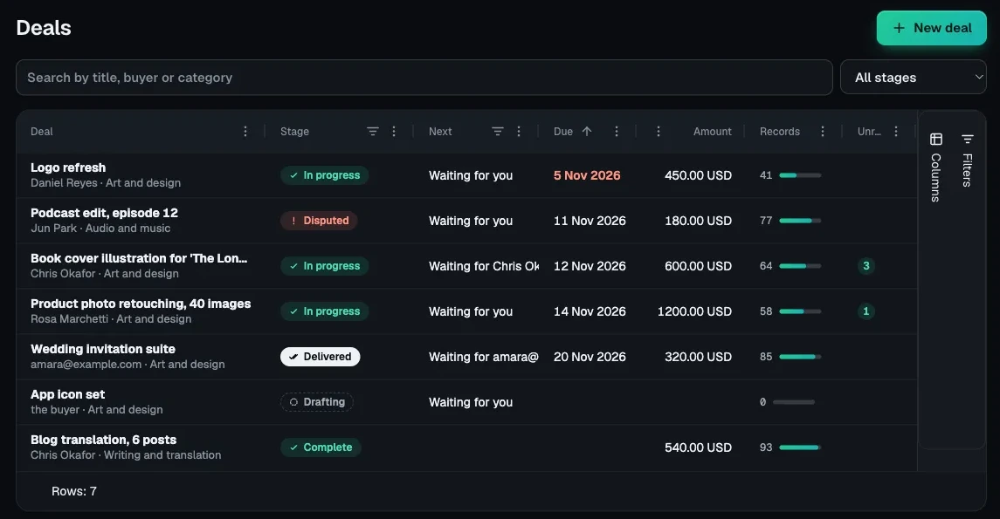

- Every deal at a glance: its stage, who it is waiting on, the next due date, the amount, the records score and unread messages.
- Enterprise features at work: filters by value, the Columns and Filters panels, grouping by stage or by who a deal is waiting on, live row counts, and CSV and Excel export.
- Search across title, buyer and category. Late steps turn red. A click, or Enter, opens the deal.
- Styled from PactPal's own design tokens, so it follows light and dark mode.

Code: [`DealsTable.tsx`](apps/web/src/app/DealsTable.tsx)

### AG Studio: the Insights dashboard

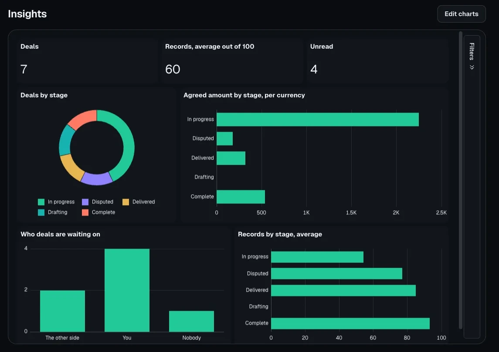

- Charts of the seller's whole book: deals by stage, agreed amounts by stage and currency, who deals are waiting on, and the records score by stage.
- The seller can edit the charts and filters. Their layout is kept in the browser.
- Charts take PactPal's colors in light and dark mode, and stack into one column on a phone.

Code: [`Insights.tsx`](apps/web/src/app/Insights.tsx), [`insight-report.ts`](apps/web/src/app/insight-report.ts)

### Bryntum: timelines and deadlines

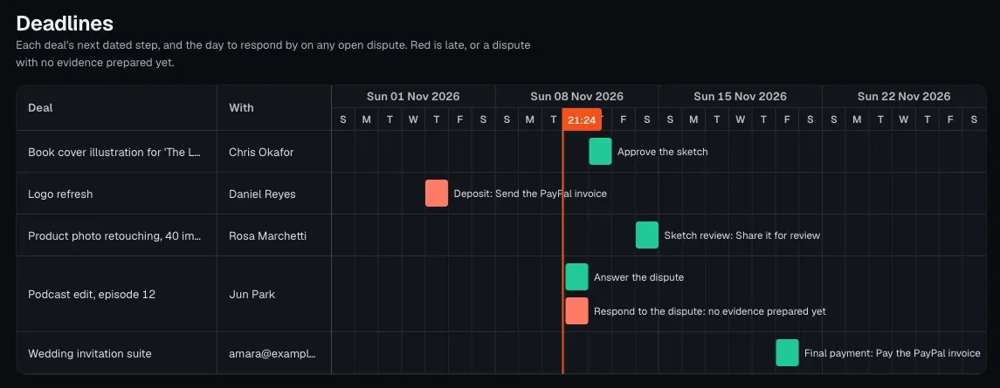

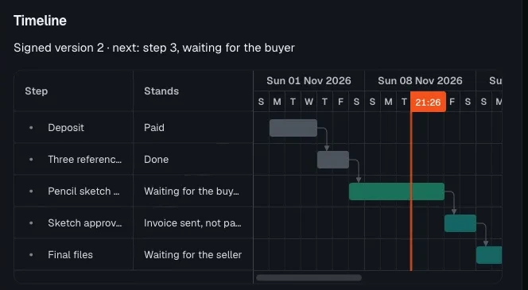

- **Scheduler, across all deals.** Every dated step and every dispute deadline on one calendar. A dispute with no evidence prepared yet shows in red, so a response date is hard to miss. A click opens the deal.
- **Gantt, on each deal.** The signed timeline as a chain of steps: deposit, references, sketch, approval, payments, delivery. A late step visibly pushes the ones after it. Colors show done, current, late and held up, with a line for today.
- Dates come from the signed record. Bryntum only shows them, so a chart can never move an agreed date.

Code: [`Deadlines.tsx`](apps/web/src/schedule/Deadlines.tsx), [`DealGantt.tsx`](apps/web/src/schedule/DealGantt.tsx)

### Channel3: what exactly is being sold

- For goods and digital products, the seller pastes the product's listing link. Channel3 reads it into clean facts: title, brand, description, materials, features, price and up to 3 photos.
- The buyer signs those facts with the rest of the agreement. The photos are saved and fingerprinted, so they become exhibits in a dispute packet.
- When a buyer later says "not as described", the AI compares the claim with the listed facts the buyer signed.
- AI assistants can read listings too, with the `lookup_listing` MCP tool. Lookups are cached in Render Key Value.

Code: [`channel3.ts`](packages/products/src/channel3.ts) · More: [What's being sold](docs/product.md#whats-being-sold-channel3)

## Try it

<!-- TODO(demo): fill in once the demo data and video are final: judge accounts, the stories to open, and what to click. -->

> **Coming soon:** a short guide for judges with ready-made seller and buyer accounts and the demo deals to open.

Until then: open **[pact-pal.app](https://pact-pal.app)**, choose **Sign in with PayPal** and sign in with a PayPal **sandbox** account. Everything runs on PayPal's sandbox, so no real money moves.

## Run it locally

Requires Node 22+ and pnpm 10+. Postgres 16 is needed for deals; set `DATABASE_URL` when you want them.

```bash
pnpm install
cp .env.example .env   # add your own sandbox and AI keys
pnpm test
pnpm dev               # server on :3000, web on Vite's port
```

`GET /health` lists the settings that are still missing. Every variable is explained in [`.env.example`](.env.example).

Useful commands:

| Command                                 | What it does                                 |
| --------------------------------------- | -------------------------------------------- |
| `pnpm verify`                           | Every check CI runs                          |
| `pnpm sandbox:check`                    | Checks the PayPal sandbox apps, REST and MCP |
| `pnpm sandbox:webhook --register <url>` | Registers the PayPal webhook                 |
| `pnpm eval:scope`                       | Scores the AI drafts against known answers   |
| `pnpm eval:injection`                   | Runs the prompt-injection test set           |
| `pnpm graph`                            | Rebuilds the [code map](docs/code-map.md)    |

Emails are edited in [`templates/`](templates), not in code: [docs/email-templates.md](docs/email-templates.md).

## Quality

Every change passes one command, locally and in CI:

```bash
pnpm verify
```

It checks formatting, types (strict), strict lint, tests with coverage, the build, duplicate code, architecture boundaries and known vulnerabilities. **2,091 tests in 229 files** pass, with at least 90% line, branch and function coverage required. The rules: [docs/engineering-standards.md](docs/engineering-standards.md).

## Scope and limits

| Deals                                                                                             | Status    |
| ------------------------------------------------------------------------------------------------- | --------- |
| Services and digital work: design, writing, web and software, photo and video, consulting         | Supported |
| Digital products: templates, presets, courses                                                     | Supported |
| Small physical goods, handmade or made to order                                                   | Supported |
| Deposit bookings, retainers, regulated professional services                                      | Not yet   |
| Anything PayPal's Acceptable Use Policy prohibits, plus gift cards, crypto, vehicles, real estate | Blocked   |

**PactPal is not:**

- **Escrow.** It never holds money.
- **Legal advice.** It records what both sides agreed.
- **A prediction.** The records score measures records, never the outcome.
- **Proof of identity.** A typed name and an IP address are not proof of who someone is.
- **Live.** It runs on PayPal's sandbox only.

More: [Scope](docs/scope.md) · [What PactPal is and is not](docs/help/limits.md) · [Privacy](docs/privacy.md)

## Docs

| Doc                                                  | What it covers                                                                      |
| ---------------------------------------------------- | ----------------------------------------------------------------------------------- |
| [Help site](https://help.pact-pal.app)               | 20 pages for sellers, buyers and developers                                         |
| [docs/problem-evidence.md](docs/problem-evidence.md) | The problem: posts, figures and sources                                             |
| [docs/product.md](docs/product.md)                   | Product spec: flow, AI roles, ledger, packet, screens                               |
| [docs/scope.md](docs/scope.md)                       | What is in and out of scope, and why                                                |
| [docs/data-model.md](docs/data-model.md)             | Tables, the evidence log and fingerprints                                           |
| [docs/decisions.md](docs/decisions.md)               | Design decisions and their reasons                                                  |
| [docs/sandbox-notes.md](docs/sandbox-notes.md)       | What we learned about the PayPal sandbox                                            |
| [docs/deploy.md](docs/deploy.md)                     | Deploying to Render                                                                 |
| [docs/diagrams/](docs/diagrams)                      | Diagram sources; edit and rebuild with [Archify](https://github.com/tt-a1i/archify) |
| [hackathon/demo-plan.md](hackathon/demo-plan.md)     | Demo stories and cast                                                               |

## Built with

TypeScript, React, Fastify, Postgres, [Render](https://render.com), PayPal APIs, Gemini, Groq, Mistral, OpenRouter, AG Grid, Bryntum, Channel3, Resend and Three.js. Diagrams by [Archify](https://github.com/tt-a1i/archify). Code map by [graphify](https://github.com/Graphify-Labs/graphify).

## License

[MIT](LICENSE).

## Author

Sushant Patil, [sushantpatil.me](https://www.sushantpatil.me)
