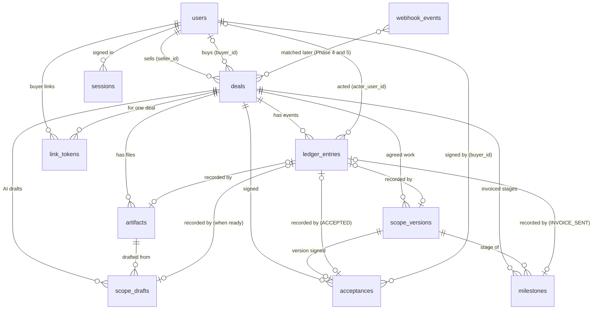

# Data model

How PactPal's database is organised, in plain words. Tables marked **built** exist in a migration; tables marked **planned** show where later sub-phases are heading and may change. Column details for built tables live in the migration (`packages/db/src/migrations.ts`); this page explains what they mean and why.

## Rules that apply everywhere

- **Ids** are uuids chosen by the server code (passed in, so tests are exact), never counters that reveal how many deals exist.
- **Money** is whole minor units (cents) plus a currency code, never decimals. A deal has one currency; amounts live on the payment stages (milestones) of the agreed work.
- **Times** are UTC and taken by the server.
- **Changes** to the structure are numbered, forward-only migrations. The database refuses edits and deletes on evidence tables.
- **Personal data** is kept to the minimum: email, one display name, PayPal ids. The evidence log refers to people by user id, so a user row can later be anonymised without touching the log. The retention policy is written in Phase 8.

## Built (sub-phases 2b to 4e)

### `users`: everyone

One row per person. "Seller" and "buyer" are roles on a deal, not kinds of person, so one person can sell in one deal and buy in another.

| Column                              | Meaning                                                                                                                                         |
| ----------------------------------- | ----------------------------------------------------------------------------------------------------------------------------------------------- |
| `id`                                | The person's PactPal id                                                                                                                         |
| `email`                             | Required. Unique ignoring upper and lower case                                                                                                  |
| `email_verified_at`                 | When the address was proven (PayPal says verified, or an emailed link was used). Empty if not proven                                            |
| `display_name`                      | One free-text name; may be empty. The legally relevant name is the one a buyer types when agreeing, which the ledger records                    |
| `paypal_user_id`, `paypal_payer_id` | PayPal's login subject and account id. Empty until the person signs in with PayPal; each unique. To be confirmed against the live sandbox in 2e |
| `created_at`, `updated_at`          | Server time                                                                                                                                     |

A person invited by email has no PayPal ids. If they later sign in with PayPal, their row is linked (only when the email is proven both ways; built in 2e).

### `deals`

| Column                     | Meaning                                                                                                                                      |
| -------------------------- | -------------------------------------------------------------------------------------------------------------------------------------------- |
| `id`                       | The deal                                                                                                                                     |
| `seller_id`                | Required; a user                                                                                                                             |
| `buyer_id`                 | A user; empty until known. The database refuses a deal where buyer and seller are the same user                                              |
| `title`                    | The deal's name, shown to both sides                                                                                                         |
| `kind`                     | `service`, `digital` or `physical`: how delivery is proven (tracked link, or shipment tracking) and PayPal's SERVICE or PRODUCT dispute type |
| `category`                 | The seller's chosen category from [scope.md](scope.md). Text checked in code, because the list changes                                       |
| `currency`                 | Three capital letters, for example `USD`                                                                                                     |
| `status`                   | `draft`, `awaiting_acceptance`, `active`, `completed`, `cancelled`. A convenience copy of the stage; the ledger is the truth (see below)     |
| `created_at`, `updated_at` | Server time                                                                                                                                  |

A dispute is not a deal status: disputes get their own table in Phase 5.

How the status moves (4a), each change in one transaction with its log entry:

| From                  | To                    | When                                            | Log entry              |
| --------------------- | --------------------- | ----------------------------------------------- | ---------------------- |
| `draft`               | `awaiting_acceptance` | The seller sends the newest version for signing | `ACCEPTANCE_REQUESTED` |
| `awaiting_acceptance` | `draft`               | The seller withdraws the request                | `ACCEPTANCE_WITHDRAWN` |
| `awaiting_acceptance` | `draft`               | The buyer declines (optional reason)            | `DECLINED`             |
| `awaiting_acceptance` | `active`              | The buyer signs with a typed name               | `ACCEPTED`             |

The agreed work can be edited only in `draft`, so the version sent is the version signed.

### `ledger_entries`: the evidence log

One row per event, never changed or removed. An entry is identified by its deal and its position (`deal_id`, `seq`), so a citation reads `deal:seq`.

| Column             | Meaning                                                                                                                                                                                                                                                                                                                                 |
| ------------------ | --------------------------------------------------------------------------------------------------------------------------------------------------------------------------------------------------------------------------------------------------------------------------------------------------------------------------------------- |
| `deal_id`, `seq`   | Which deal and which position (0, 1, 2, ...). Together they are the key, so two entries can never share a position                                                                                                                                                                                                                      |
| `type`             | What happened (for example `ACCEPTED`); checked in code against the event list                                                                                                                                                                                                                                                          |
| `actor`            | The role that acted: `seller`, `buyer` or `system`                                                                                                                                                                                                                                                                                      |
| `actor_user_id`    | The person who acted; empty for `system`. Covered by the hash                                                                                                                                                                                                                                                                           |
| `payload`          | The event's details (JSON)                                                                                                                                                                                                                                                                                                              |
| `payload_hash`     | Fingerprint of the payload                                                                                                                                                                                                                                                                                                              |
| `prev_hash`        | The previous entry's `entry_hash`: the link that makes the log a chain                                                                                                                                                                                                                                                                  |
| `entry_hash`       | Fingerprint of the whole entry including `prev_hash`. Changing anything in an entry, or any earlier one, breaks it                                                                                                                                                                                                                      |
| `server_time`      | When the server wrote it                                                                                                                                                                                                                                                                                                                |
| `ip`, `user_agent` | Where and with what the actor connected, when relevant. Plain text, because Postgres's address type rewrites addresses and the exact text is hashed. The IP address is the visitor's, worked out with the number of proxies in front of the server (`TRUST_PROXY_HOPS`, 2 on Render); without that setting only the browser is recorded |

What protects it: the database refuses updates, deletes and truncation; a deal or user with entries cannot be deleted; and verification recomputes every fingerprint and link and names the first bad entry. Someone with full database access could switch the refusal off, but could not hide the change from verification.

### `artifacts` and `file_contents`: the deal's files

A file is stored once, by the SHA-256 of its bytes, in `file_contents`; `artifacts` says which deal it belongs to and what it is. Both tables are append-only. Adding a file saves the bytes first, then in one transaction writes the ledger entry (`SOURCE_ADDED` or `DELIVERABLE_ADDED`) and the artifact, so a record never points at missing bytes.

On the website (2f-4) the seller adds `source` files; both sides list and download them, and every download is checked against the fingerprint first. Delivered work (`deliverable`) is added through delivery links in Phase 4.

| Column (`artifacts`)   | Meaning                                                                                                     |
| ---------------------- | ----------------------------------------------------------------------------------------------------------- |
| `id`, `deal_id`        | The file and its deal                                                                                       |
| `kind`                 | `source` (what the deal was made from, such as a pasted chat) or `deliverable` (delivered work)             |
| `filename`             | A plain name: 1 to 255 characters, no slashes, no control characters                                        |
| `media_type`           | Found from the bytes, never from the name: PDF, PNG, JPEG, GIF, `text/plain`, or `application/octet-stream` |
| `size_bytes`, `sha256` | The file's size and fingerprint; reading the file checks the bytes against both                             |
| `added_by`             | The user who added it; empty when the system did                                                            |
| `ledger_seq`           | The ledger entry (with `deal_id`) that recorded it                                                          |

| Column (`file_contents`) | Meaning                                                                     |
| ------------------------ | --------------------------------------------------------------------------- |
| `sha256`                 | Key: the fingerprint of the bytes. The same file added twice is stored once |
| `size_bytes`, `bytes`    | The length (checked to match) and the content                               |
| `created_at`             | Server time                                                                 |

`artifacts` has no database link to `file_contents`, so the bytes can move to object storage later by changing one adapter. Limits protect the 1 GB database: 10 MB per file and 50 MB per deal.

### `webhook_events`: notifications as received

A webhook is a message PayPal posts to our server when something happens (an invoice created or paid). Each genuine one is saved here in full, exactly once, before the server answers "got it", so a repeat is recognised even after a restart and nothing PayPal tells us is lost. Handling the contents (a milestone paid, a dispute matched) comes in Phases 4 and 5; this table is not the evidence record, the ledger is.

| Column               | Meaning                                                                                                |
| -------------------- | ------------------------------------------------------------------------------------------------------ |
| `source`, `event_id` | Who sent it (`paypal`) and its own id for the event. Together the key: the same pair again is a repeat |
| `event_type`         | What happened, in PayPal's words (for example `INVOICING.INVOICE.PAID`)                                |
| `resource_type`      | What it is about (for example `invoices`); may be empty                                                |
| `event_created_at`   | When PayPal says it happened; empty if PayPal's value was not a date                                   |
| `received_at`        | When our server received it (UTC)                                                                      |
| `body`               | The whole event as received. Contains buyer details, so the retention rule (Phase 8) applies           |

Unlike the ledger it can be changed and deleted: later phases will mark events as processed, and a retention purge may need to remove old ones.

### `sessions`: who is signed in

One row per sign-in. The browser holds a random 43-character token in a cookie that page scripts cannot read; the table stores only the token's SHA-256, so the table itself cannot be used to sign in.

| Column                     | Meaning                                                            |
| -------------------------- | ------------------------------------------------------------------ |
| `token_hash`               | SHA-256 of the cookie's token (the key)                            |
| `user_id`                  | Who is signed in. Deleting a user deletes their sessions           |
| `created_at`, `expires_at` | When the sign-in happened and when it stops working (7 days later) |

An expired session is refused and removed when it is next used; signing out deletes it.

### `link_tokens`: buyer links

A private link that lets a deal's buyer into that one deal without a PayPal account. The secret travels after `#` in the address (`/link#t=...`), so the server never logs it; only its SHA-256 is stored. Opening the link shows a "Continue" button, because mail scanners open links but do not press buttons.

| Column                     | Meaning                                                       |
| -------------------------- | ------------------------------------------------------------- |
| `token_hash`               | SHA-256 of the link's secret (the key)                        |
| `deal_id`, `user_id`       | The deal it opens and the buyer it is for                     |
| `purpose`                  | `deal-access` for now                                         |
| `created_at`, `expires_at` | When it was made and when it stops working (14 days later)    |
| `revoked_at`               | Set when a newer link for the same deal and buyer replaces it |
| `last_used_at`             | The last time it let someone in                               |

Using a link marks the buyer's email as proven and starts a session limited to that deal.

### `scope_versions`: the agreed work

What a deal covers and how its price is split into payment stages. Each save by the seller is a new numbered version; old versions are kept and the database refuses edits, deletes and emptying the table.

| Column               | Meaning                                                                                                                                                                                   |
| -------------------- | ----------------------------------------------------------------------------------------------------------------------------------------------------------------------------------------- |
| `deal_id`, `version` | Which deal and which version (1, 2, 3, ...). Together the key. The number is chosen while the deal row is locked, so two saves at once get different numbers                              |
| `format`             | Which content layout the version uses. Format 1 is written by the seller; AI drafts with quotes from the source (Phase 3) will be a new format                                            |
| `content`            | The agreed work (JSON): summary, what will be delivered, what is not included, revisions included, due date, and 1 to 20 payment stages (title, amount in minor units, optional due date) |
| `content_sha256`     | Fingerprint of the content's canonical JSON. Checked every time a version is read; the same value is in the ledger entry                                                                  |
| `created_by`         | The seller who saved it                                                                                                                                                                   |
| `ledger_seq`         | The `SCOPE_VERSIONED` ledger entry (with `deal_id`) that recorded it. Its payload holds the version, fingerprint, total, currency and number of stages                                    |
| `created_at`         | Server time                                                                                                                                                                               |

When a version is saved from an AI draft (see `scope_drafts`), the ledger also gets a `SCOPE_CONFIRMED` entry right after the `SCOPE_VERSIONED` one: the version, its fingerprint, the draft's id and fingerprint (the stored winner's), and, when the council could not rank its drafts and the seller chose one, `usedCandidate` (its letter and fingerprint); then for each of summary, deliverables, exclusions, revisions, due date and total price whether the seller kept it (`unchanged`), `changed` it, `added` it (the draft left it missing) or `removed` it. It holds no text. When `usedCandidate` is present, the kept/changed words compare with that draft, not with the winner.

Payment stages are part of the content, so their titles and amounts are fingerprinted and frozen with the rest: changing an amount means saving a new version. Only the seller can save, and only while the deal is a draft.

### `acceptances`: signed agreements

What the buyer signed, kept whole. Built in 4a (migration 0009). Append-only: the database refuses edits, deletes and emptying the table.

The buyer's page is drawn only from an **acceptance document** (format 1), plain data built by the server: the deal title, category, the seller's display name, the version of the agreed work with its fingerprint, every term with amounts in minor units and as text, the total, and the notice shown above the sign button (with its version). Its fingerprint is the SHA-256 of its canonical JSON. When the buyer signs, the server rebuilds the document and refuses if it differs from the one their page showed.

| Column                        | Meaning                                                                                        |
| ----------------------------- | ---------------------------------------------------------------------------------------------- |
| `deal_id`, `ledger_seq`       | The deal and its `ACCEPTED` ledger entry. Together the key                                     |
| `version`                     | The version of the agreed work signed (must exist in `scope_versions`). Unique per deal        |
| `document`, `document_sha256` | The acceptance document exactly as shown, and its fingerprint; checked on every read           |
| `buyer_id`                    | The buyer who signed                                                                           |
| `typed_name`                  | The name the buyer typed (2–200 characters). Not compared with anything; not proof of identity |
| `created_at`                  | Server time                                                                                    |

The `ACCEPTED` entry holds the version, the content and document fingerprints, the typed name, the notice version and how the buyer reached the page (`link` or `paypal`), plus the browser and, when known, the IP address. The typed name and the terms are personal data, so the retention rule (Phase 8) applies. Change orders (4j) will add further rows for later versions.

When the email service accepts a receipt email (4c), a **`RECEIPT_SENT`** entry (by the system) records the version, which side it went to (`buyer` or `seller`), the receipt's SHA-256, a SHA-256 of the lower-cased address (never the address) and Resend's message id. A failed send records nothing. At most 5 receipt emails are sent per signed version.

The **receipt PDF** (4b) is not stored: it is made from the newest row each time it is downloaded, after checking the row against its fingerprint and against its `ACCEPTED` entry (same document fingerprint, typed name and time). The same row always gives the same bytes.

### `milestones`: payment stages invoiced through PayPal

Built in 4d (migration 0010). One row per payment stage of the **signed** version that has a PayPal invoice; the stage's title, amount and due date stay in the signed version (`scope_versions`), so they are fingerprinted with it. Not append-only: the status moves on, and the evidence is the `INVOICE_SENT` entry.

| Column                                            | Meaning                                                                                                                                            |
| ------------------------------------------------- | -------------------------------------------------------------------------------------------------------------------------------------------------- |
| `deal_id`, `version`, `stage`                     | The deal, the signed version and the stage number (from 1). Together the key                                                                       |
| `amount_minor`, `currency`                        | What was invoiced                                                                                                                                  |
| `status`                                          | `sending` (reserved before PayPal is asked), `sent` (PayPal confirmed), `paid` (4e)                                                                |
| `request_id`                                      | The fixed `PayPal-Request-Id`, `pp-<deal>-v<version>-s<stage>`: every retry reaches PayPal as the same request, so a stage is never invoiced twice |
| `invoice_sha256`                                  | Fingerprint of the item name, description, note and amount the seller confirmed                                                                    |
| `invoice_id`, `pay_url`                           | PayPal's invoice id (also kept for a created-but-unsent invoice, so a retry re-sends it) and the buyer's view-and-pay link                         |
| `ledger_seq`, `sent_at`                           | The `INVOICE_SENT` entry and when it was sent; set together with `sent`                                                                            |
| `paid_at`, `payment_ledger_seq`, `transaction_id` | Once PayPal confirms the invoice fully paid (4e): when, the `PAYMENT_RECEIVED` entry, and PayPal's transaction id. Set together with `paid`        |
| `created_at`                                      | When the stage was reserved                                                                                                                        |

`PAYMENT_RECEIVED` (by the system, 4e) holds the version, stage, PayPal invoice id, the amount PayPal says was paid, PayPal's transactions (id, date, method) and how PactPal learned of it (`notification` with PayPal's event id, or `status-check`). It is written once, only after PactPal re-read the invoice from PayPal and found it `PAID`.

`INVOICE_SENT` (by the seller) holds the version, stage, PayPal invoice id, amount and currency, the fingerprints of the agreed work and of the invoice text, a SHA-256 of the buyer's lower-cased address (never the address) and the route PayPal answered by (`rest`).

### `scope_drafts`: AI drafts of the agreed work

A draft is a proposal made by the council from a chat saved as a text source file. It is not evidence and not an agreement, so it lives in its own table and is not append-only: a row starts as `running` and moves once to `ready` or `failed`. Only a `ready` draft is recorded in the ledger (`SCOPE_DRAFTED`, by fingerprint, never with text). Nothing becomes agreed work until the seller confirms it (3e).

| Column                                        | Meaning                                                                                                                                                                                                    |
| --------------------------------------------- | ---------------------------------------------------------------------------------------------------------------------------------------------------------------------------------------------------------- |
| `id`, `deal_id`                               | The draft and its deal                                                                                                                                                                                     |
| `source_artifact_id`, `source_sha256`         | The chat file it was made from (the database makes it a file of the same deal) and that file's fingerprint, so every citation can be checked against it                                                    |
| `created_by`                                  | The seller who asked                                                                                                                                                                                       |
| `status`                                      | `running`, `ready` or `failed`. At most one `running` per deal                                                                                                                                             |
| `created_at`, `finished_at`                   | Server time                                                                                                                                                                                                |
| `draft_prompt_version`, `rank_prompt_version` | Which wording of the drafting and ranking prompts produced it (drafting wording 2 since 3fb)                                                                                                               |
| `draft`, `draft_sha256`                       | The winning draft (JSON) and the fingerprint of its canonical JSON; checked on every read. Only on `ready`                                                                                                 |
| `council`                                     | What each model did (valid, invalid with reasons, failed), the votes, which label was which model, every valid draft, scores, agreement, tokens and time. On `ready`, and on `failed` when the council ran |
| `failure_reason`                              | Why it failed; never repeats the chat. Only on `failed`                                                                                                                                                    |
| `ledger_seq`                                  | The `SCOPE_DRAFTED` entry (with `deal_id`). Only on `ready`                                                                                                                                                |

Lines of the chat that look like orders to an AI are not stored anywhere; they are found again from the chat file whenever a finished draft is read (`source.hiddenLines`, line numbers only). A deal can have at most 10 drafts. A draft still `running` when the server restarts is marked `failed`. The chat quotes inside `draft` and `council` are personal data, so the retention rule (Phase 8) applies.

## Planned

| Table                               | Sub-phase | What it will hold                                                                                                            |
| ----------------------------------- | --------- | ---------------------------------------------------------------------------------------------------------------------------- |
| `artifacts` and their file contents | 2c        | Uploaded files: name, type, size, SHA-256, who added it and the ledger entry that recorded it; the bytes in a separate table |
| `webhook_events`                    | 2d        | PayPal notifications as received, one row per event id, so repeats are skipped even after a restart                          |
| `link_tokens`                       | 2e-2      | Single-purpose expiring links tied to one deal and one person, for buyers who do not sign in; only hashes are stored         |
| `scope_versions`                    | 2f-3      | The agreed work, each version kept and never edited, with its payment stages                                                 |
| disputes and evidence packets       | Phase 5   | Created when Phase 5 is designed                                                                                             |
