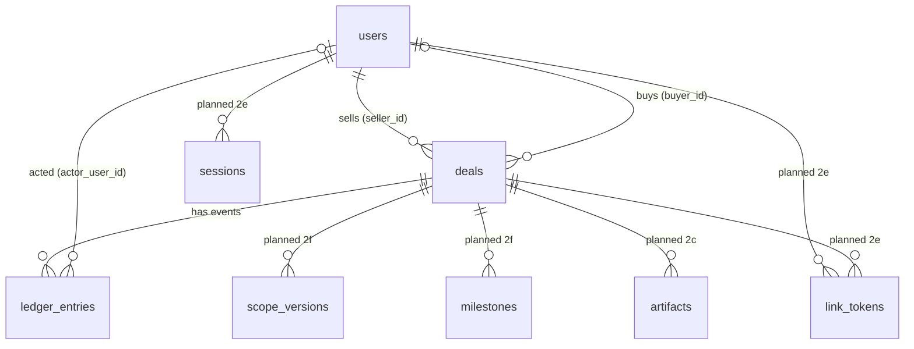

# Data model

How PactPal's database is organised, in plain words. Tables marked **built** exist in a migration; tables marked **planned** show where later sub-phases are heading and may change. Column details for built tables live in the migration (`packages/db/src/migrations.ts`); this page explains what they mean and why.

## Rules that apply everywhere

- **Ids** are uuids chosen by the server code (passed in, so tests are exact), never counters that reveal how many deals exist.
- **Money** is whole minor units (cents) plus a currency code, never decimals. A deal has one currency; amounts live on milestones.
- **Times** are UTC and taken by the server.
- **Changes** to the structure are numbered, forward-only migrations. The database refuses edits and deletes on evidence tables.
- **Personal data** is kept to the minimum: email, one display name, PayPal ids. The evidence log refers to people by user id, so a user row can later be anonymised without touching the log. The retention policy is written in Phase 8.

## Built (sub-phase 2b)

### `users`: everyone

One row per person. "Seller" and "buyer" are roles on a deal, not kinds of person, so one person can sell in one deal and buy in another.

| Column                              | Meaning                                                                                                                                         |
| ----------------------------------- | ----------------------------------------------------------------------------------------------------------------------------------------------- |
| `id`                                | The person's PactPal id                                                                                                                         |
| `email`                             | Required. Unique ignoring upper and lower case                                                                                                  |
| `email_verified_at`                 | When the address was proven (PayPal says verified, or an emailed link was used). Empty if not proven                                            |
| `display_name`                      | One free-text name; may be empty. The legally relevant name is the one a buyer types when agreeing, which the ledger records                    |
| `paypal_user_id`, `paypal_payer_id` | PayPal's login subject and account id. Empty until the person signs in with PayPal; each unique. To be confirmed against the live sandbox in 2e |
| `created_at`, `updated_at`          | Server time                                                                                                                                     |

A person invited by email has no PayPal ids. If they later sign in with PayPal, their row is linked (only when the email is proven both ways; built in 2e).

### `deals`

| Column                     | Meaning                                                                                                                                      |
| -------------------------- | -------------------------------------------------------------------------------------------------------------------------------------------- |
| `id`                       | The deal                                                                                                                                     |
| `seller_id`                | Required; a user                                                                                                                             |
| `buyer_id`                 | A user; empty until known. The database refuses a deal where buyer and seller are the same user                                              |
| `title`                    | The deal's name, shown to both sides                                                                                                         |
| `kind`                     | `service`, `digital` or `physical`: how delivery is proven (tracked link, or shipment tracking) and PayPal's SERVICE or PRODUCT dispute type |
| `category`                 | The seller's chosen category from [scope.md](scope.md). Text checked in code, because the list changes                                       |
| `currency`                 | Three capital letters, for example `USD`                                                                                                     |
| `status`                   | `draft`, `awaiting_acceptance`, `active`, `completed`, `cancelled`. A convenience copy of the stage; the ledger is the truth                 |
| `created_at`, `updated_at` | Server time                                                                                                                                  |

A dispute is not a deal status: disputes get their own table in Phase 5.

### `ledger_entries`: the evidence log

One row per event, never changed or removed. An entry is identified by its deal and its position (`deal_id`, `seq`), so a citation reads `deal:seq`.

| Column             | Meaning                                                                                                                                             |
| ------------------ | --------------------------------------------------------------------------------------------------------------------------------------------------- |
| `deal_id`, `seq`   | Which deal and which position (0, 1, 2, ...). Together they are the key, so two entries can never share a position                                  |
| `type`             | What happened (for example `ACCEPTED`); checked in code against the event list                                                                      |
| `actor`            | The role that acted: `seller`, `buyer` or `system`                                                                                                  |
| `actor_user_id`    | The person who acted; empty for `system`. Covered by the hash                                                                                       |
| `payload`          | The event's details (JSON)                                                                                                                          |
| `payload_hash`     | Fingerprint of the payload                                                                                                                          |
| `prev_hash`        | The previous entry's `entry_hash`: the link that makes the log a chain                                                                              |
| `entry_hash`       | Fingerprint of the whole entry including `prev_hash`. Changing anything in an entry, or any earlier one, breaks it                                  |
| `server_time`      | When the server wrote it                                                                                                                            |
| `ip`, `user_agent` | Where and with what the actor connected, when relevant. Plain text, because Postgres's address type rewrites addresses and the exact text is hashed |

What protects it: the database refuses updates, deletes and truncation; a deal or user with entries cannot be deleted; and verification recomputes every fingerprint and link and names the first bad entry. Someone with full database access could switch the refusal off, but could not hide the change from verification.

## Planned

| Table                               | Sub-phase | What it will hold                                                                                                              |
| ----------------------------------- | --------- | ------------------------------------------------------------------------------------------------------------------------------ |
| `artifacts` and their file contents | 2c        | Uploaded files: name, type, size, SHA-256, who added it and the ledger entry that recorded it; the bytes in a separate table   |
| `webhook_events`                    | 2d        | PayPal notifications as received, one row per event id, so repeats are skipped even after a restart                            |
| `sessions`, `link_tokens`           | 2e        | Signed-in sessions, and single-purpose expiring links tied to one deal and one person; only hashes of secrets are stored       |
| `scope_versions`, `milestones`      | 2f        | The agreed scope (each version kept, never edited) and the milestones with amounts in minor units and their PayPal invoice ids |
| disputes and evidence packets       | Phase 5   | Created when Phase 5 is designed                                                                                               |
