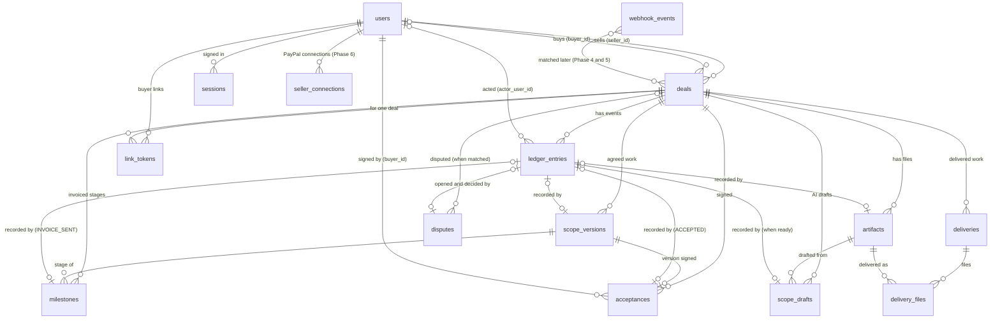

# Data model

How PactPal's database is organised, in plain words. Tables marked **built** exist in a migration; tables marked **planned** show where later sub-phases are heading and may change. Column details for built tables live in the migration (`packages/db/src/migrations.ts`); this page explains what they mean and why.

## Rules that apply everywhere

- **Ids** are uuids chosen by the server code (passed in, so tests are exact), never counters that reveal how many deals exist.
- **Money** is whole minor units (cents) plus a currency code, never decimals. A deal has one currency; amounts live on the payment stages (milestones) of the agreed work.
- **Times** are UTC and taken by the server.
- **Changes** to the structure are numbered, forward-only migrations. The database refuses edits and deletes on evidence tables.
- **Personal data** is kept to the minimum: email, one display name, PayPal ids. The evidence log refers to people by user id, so a user row can later be anonymised without touching the log. The retention policy is written in Phase 9.

## Built (sub-phases 2b to 6h-1)

### `users`: everyone

One row per person. "Seller" and "buyer" are roles on a deal, not kinds of person, so one person can sell in one deal and buy in another.

| Column                              | Meaning                                                                                                                                         |
| ----------------------------------- | ----------------------------------------------------------------------------------------------------------------------------------------------- |
| `id`                                | The person's PactPal id                                                                                                                         |
| `email`                             | Required. Unique ignoring upper and lower case                                                                                                  |
| `email_verified_at`                 | When the address was proven (PayPal says verified, or an emailed link was used). Empty if not proven                                            |
| `display_name`                      | One free-text name; may be empty. The legally relevant name is the one a buyer types when agreeing, which the ledger records                    |
| `paypal_user_id`, `paypal_payer_id` | PayPal's login subject and account id. Empty until the person signs in with PayPal; each unique. To be confirmed against the live sandbox in 2e |
| `created_at`, `updated_at`          | Server time                                                                                                                                     |

A person invited by email has no PayPal ids. If they later sign in with PayPal, their row is linked (only when the email is proven both ways; built in 2e).

### `deals`

| Column                     | Meaning                                                                                                                                      |
| -------------------------- | -------------------------------------------------------------------------------------------------------------------------------------------- |
| `id`                       | The deal                                                                                                                                     |
| `seller_id`                | Required; a user                                                                                                                             |
| `buyer_id`                 | A user; empty until known. The database refuses a deal where buyer and seller are the same user                                              |
| `title`                    | The deal's name, shown to both sides                                                                                                         |
| `kind`                     | `service`, `digital` or `physical`: how delivery is proven (tracked link, or shipment tracking) and PayPal's SERVICE or PRODUCT dispute type |
| `category`                 | The seller's chosen category from [scope.md](scope.md). Text checked in code, because the list changes                                       |
| `currency`                 | Three capital letters, for example `USD`                                                                                                     |
| `status`                   | `draft`, `awaiting_acceptance`, `active`, `completed`, `cancelled`. A convenience copy of the stage; the ledger is the truth (see below)     |
| `created_at`, `updated_at` | Server time                                                                                                                                  |

A dispute is not a deal status: disputes get their own table in Phase 5.

How the status moves (4a), each change in one transaction with its log entry:

| From                  | To                    | When                                            | Log entry              |
| --------------------- | --------------------- | ----------------------------------------------- | ---------------------- |
| `draft`               | `awaiting_acceptance` | The seller sends the newest version for signing | `ACCEPTANCE_REQUESTED` |
| `awaiting_acceptance` | `draft`               | The seller withdraws the request                | `ACCEPTANCE_WITHDRAWN` |
| `awaiting_acceptance` | `draft`               | The buyer declines (optional reason)            | `DECLINED`             |
| `awaiting_acceptance` | `active`              | The buyer signs with a typed name               | `ACCEPTED`             |
| `active`              | `completed`           | The buyer approves the last unapproved stage    | `MILESTONE_APPROVED`   |

The agreed work can be edited only in `draft`, so the version sent is the version signed.

### `ledger_entries`: the evidence log

One row per event, never changed or removed. An entry is identified by its deal and its position (`deal_id`, `seq`), so a citation reads `deal:seq`.

| Column             | Meaning                                                                                                                                                                                                                                                                                                                                 |
| ------------------ | --------------------------------------------------------------------------------------------------------------------------------------------------------------------------------------------------------------------------------------------------------------------------------------------------------------------------------------- |
| `deal_id`, `seq`   | Which deal and which position (0, 1, 2, ...). Together they are the key, so two entries can never share a position                                                                                                                                                                                                                      |
| `type`             | What happened (for example `ACCEPTED`); checked in code against the event list                                                                                                                                                                                                                                                          |
| `actor`            | The role that acted: `seller`, `buyer` or `system`                                                                                                                                                                                                                                                                                      |
| `actor_user_id`    | The person who acted; empty for `system`. Covered by the hash                                                                                                                                                                                                                                                                           |
| `payload`          | The event's details (JSON)                                                                                                                                                                                                                                                                                                              |
| `payload_hash`     | Fingerprint of the payload                                                                                                                                                                                                                                                                                                              |
| `prev_hash`        | The previous entry's `entry_hash`: the link that makes the log a chain                                                                                                                                                                                                                                                                  |
| `entry_hash`       | Fingerprint of the whole entry including `prev_hash`. Changing anything in an entry, or any earlier one, breaks it                                                                                                                                                                                                                      |
| `server_time`      | When the server wrote it                                                                                                                                                                                                                                                                                                                |
| `ip`, `user_agent` | Where and with what the actor connected, when relevant. Plain text, because Postgres's address type rewrites addresses and the exact text is hashed. The IP address is the visitor's, worked out with the number of proxies in front of the server (`TRUST_PROXY_HOPS`, 2 on Render); without that setting only the browser is recorded |

What protects it: the database refuses updates, deletes and truncation; a deal or user with entries cannot be deleted; and verification recomputes every fingerprint and link and names the first bad entry. Someone with full database access could switch the refusal off, but could not hide the change from verification.

### `artifacts` and `file_contents`: the deal's files

A file is stored once, by the SHA-256 of its bytes, in `file_contents`; `artifacts` says which deal it belongs to and what it is. Both tables are append-only. Adding a file saves the bytes first, then in one transaction writes the ledger entry (`SOURCE_ADDED` or `DELIVERABLE_ADDED`) and the artifact, so a record never points at missing bytes.

On the website (2f-4) the seller adds `source` files; both sides list and download them, and every download is checked against the fingerprint first. Delivered work (`deliverable`) is added through delivery links in Phase 4.

Since 5b the buyer also adds `source` files (reference material such as a brief or pictures), signed in or by their private link: `added_by` is then the buyer, and the `SOURCE_ADDED` entry has actor `buyer` with IP address and browser. A buyer adds only PDF, PNG, JPEG, GIF or plain text, at most 20 files and 20 MB per deal. The files list says who added each file (seller, buyer or PactPal).

| Column (`artifacts`)   | Meaning                                                                                                     |
| ---------------------- | ----------------------------------------------------------------------------------------------------------- |
| `id`, `deal_id`        | The file and its deal                                                                                       |
| `kind`                 | `source` (what the deal was made from, such as a pasted chat) or `deliverable` (delivered work)             |
| `filename`             | A plain name: 1 to 255 characters, no slashes, no control characters                                        |
| `media_type`           | Found from the bytes, never from the name: PDF, PNG, JPEG, GIF, `text/plain`, or `application/octet-stream` |
| `size_bytes`, `sha256` | The file's size and fingerprint; reading the file checks the bytes against both                             |
| `added_by`             | The user who added it (the seller, or since 5b the buyer); empty when the system did                        |
| `ledger_seq`           | The ledger entry (with `deal_id`) that recorded it                                                          |

| Column (`file_contents`) | Meaning                                                                     |
| ------------------------ | --------------------------------------------------------------------------- |
| `sha256`                 | Key: the fingerprint of the bytes. The same file added twice is stored once |
| `size_bytes`, `bytes`    | The length (checked to match) and the content                               |
| `created_at`             | Server time                                                                 |

`artifacts` has no database link to `file_contents`, so the bytes can move to object storage later by changing one adapter. Limits protect the 1 GB database: 10 MB per file and 50 MB per deal.

### `webhook_events`: notifications as received

A webhook is a message PayPal posts to our server when something happens (an invoice created or paid). Each genuine one is saved here in full, exactly once, before the server answers "got it", so a repeat is recognised even after a restart and nothing PayPal tells us is lost. Handling the contents (a milestone paid, a dispute matched) comes in Phases 4 and 5; this table is not the evidence record, the ledger is.

| Column               | Meaning                                                                                                                                                                           |
| -------------------- | --------------------------------------------------------------------------------------------------------------------------------------------------------------------------------- |
| `source`, `event_id` | Who sent it (`paypal`, or `resend` for forwarded emails since 4p-2, keyed by the Svix message id) and its own id for the event. Together the key: the same pair again is a repeat |
| `event_type`         | What happened, in PayPal's words (for example `INVOICING.INVOICE.PAID`)                                                                                                           |
| `resource_type`      | What it is about (for example `invoices`); may be empty                                                                                                                           |
| `event_created_at`   | When PayPal says it happened; empty if PayPal's value was not a date                                                                                                              |
| `received_at`        | When our server received it (UTC)                                                                                                                                                 |
| `body`               | The whole event as received. Contains buyer details, so the retention rule (Phase 9) applies                                                                                      |

Unlike the ledger it can be changed and deleted: later phases will mark events as processed, and a retention purge may need to remove old ones.

### `sessions`: who is signed in

One row per sign-in. The browser holds a random 43-character token in a cookie that page scripts cannot read; the table stores only the token's SHA-256, so the table itself cannot be used to sign in.

| Column                     | Meaning                                                            |
| -------------------------- | ------------------------------------------------------------------ |
| `token_hash`               | SHA-256 of the cookie's token (the key)                            |
| `user_id`                  | Who is signed in. Deleting a user deletes their sessions           |
| `created_at`, `expires_at` | When the sign-in happened and when it stops working (7 days later) |

An expired session is refused and removed when it is next used; signing out deletes it.

### `link_tokens`: buyer links

A private link that lets a deal's buyer into that one deal without a PayPal account. The secret travels after `#` in the address (`/link#t=...`), so the server never logs it; only its SHA-256 is stored. Opening the link shows a "Continue" button, because mail scanners open links but do not press buttons.

| Column                     | Meaning                                                       |
| -------------------------- | ------------------------------------------------------------- |
| `token_hash`               | SHA-256 of the link's secret (the key)                        |
| `deal_id`, `user_id`       | The deal it opens and the buyer it is for                     |
| `purpose`                  | `deal-access` for now                                         |
| `created_at`, `expires_at` | When it was made and when it stops working (14 days later)    |
| `revoked_at`               | Set when a newer link for the same deal and buyer replaces it |
| `last_used_at`             | The last time it let someone in                               |

Using a link marks the buyer's email as proven and starts a session limited to that deal.

### `scope_versions`: the agreed work

What a deal covers and how its price is split into payment stages. Each save by the seller is a new numbered version; old versions are kept and the database refuses edits, deletes and emptying the table.

| Column               | Meaning                                                                                                                                                                                   |
| -------------------- | ----------------------------------------------------------------------------------------------------------------------------------------------------------------------------------------- |
| `deal_id`, `version` | Which deal and which version (1, 2, 3, ...). Together the key. The number is chosen while the deal row is locked, so two saves at once get different numbers                              |
| `format`             | Which content layout the version uses. Format 1 is written by the seller; AI drafts with quotes from the source (Phase 3) will be a new format                                            |
| `content`            | The agreed work (JSON): summary, what will be delivered, what is not included, revisions included, due date, and 1 to 20 payment stages (title, amount in minor units, optional due date) |
| `content_sha256`     | Fingerprint of the content's canonical JSON. Checked every time a version is read; the same value is in the ledger entry                                                                  |
| `created_by`         | The seller who saved it                                                                                                                                                                   |
| `ledger_seq`         | The `SCOPE_VERSIONED` ledger entry (with `deal_id`) that recorded it. Its payload holds the version, fingerprint, total, currency and number of stages                                    |
| `created_at`         | Server time                                                                                                                                                                               |

When a version is saved from an AI draft (see `scope_drafts`), the ledger also gets a `SCOPE_CONFIRMED` entry right after the `SCOPE_VERSIONED` one: the version, its fingerprint, the draft's id and fingerprint (the stored winner's), and, when the council could not rank its drafts and the seller chose one, `usedCandidate` (its letter and fingerprint); then for each of summary, deliverables, exclusions, revisions, due date and total price whether the seller kept it (`unchanged`), `changed` it, `added` it (the draft left it missing) or `removed` it. It holds no text. When `usedCandidate` is present, the kept/changed words compare with that draft, not with the winner.

Payment stages are part of the content, so their titles and amounts are fingerprinted and frozen with the rest: changing an amount means saving a new version. Only the seller can save, and only while the deal is a draft.

Since 4i the content can also hold `buyerProvides`: up to 20 things the buyer provides, each with text (1 to 500 characters) and an optional date. It is still format 1: the list is optional and never stored empty, so versions saved before it existed keep their exact content and fingerprint. The acceptance document's terms carry it only when present, so documents for older versions are rebuilt byte for byte.

Since 4i-2 the content can also hold `deliverableKinds`: one mark per line of what will be delivered, in the same order: `objective` (can be checked), `process` (a step in the work), `subjective` (a matter of taste, with the `approvalStage` whose approval by the buyer settles it), or `null` (not marked). It is stored only when at least one line is marked, must have one entry per line, and a stage must exist in the version. The acceptance document carries it only when present. The deliveries view lists, for each delivery, the matters of taste its stage settles.

### `acceptances`: signed agreements

What the buyer signed, kept whole. Built in 4a (migration 0009). Append-only: the database refuses edits, deletes and emptying the table.

The buyer's page is drawn only from an **acceptance document** (format 1), plain data built by the server: the deal title, category, the seller's display name, the version of the agreed work with its fingerprint, every term with amounts in minor units and as text, the total, and the notice shown above the sign button (with its version). Its fingerprint is the SHA-256 of its canonical JSON. When the buyer signs, the server rebuilds the document and refuses if it differs from the one their page showed.

| Column                        | Meaning                                                                                        |
| ----------------------------- | ---------------------------------------------------------------------------------------------- |
| `deal_id`, `ledger_seq`       | The deal and its `ACCEPTED` ledger entry. Together the key                                     |
| `version`                     | The version of the agreed work signed (must exist in `scope_versions`). Unique per deal        |
| `document`, `document_sha256` | The acceptance document exactly as shown, and its fingerprint; checked on every read           |
| `buyer_id`                    | The buyer who signed                                                                           |
| `typed_name`                  | The name the buyer typed (2–200 characters). Not compared with anything; not proof of identity |
| `created_at`                  | Server time                                                                                    |

The `ACCEPTED` entry holds the version, the content and document fingerprints, the typed name, the notice version and how the buyer reached the page (`link` or `paypal`), plus the browser and, when known, the IP address. The typed name and the terms are personal data, so the retention rule (Phase 9) applies. Change orders (4j) will add further rows for later versions.

When the email service accepts a receipt email (4c), a **`RECEIPT_SENT`** entry (by the system) records the version, which side it went to (`buyer` or `seller`), the receipt's SHA-256, a SHA-256 of the lower-cased address (never the address) and Resend's message id. A failed send records nothing. At most 5 receipt emails are sent per signed version.

The **receipt PDF** (4b) is not stored: it is made from the newest row each time it is downloaded, after checking the row against its fingerprint and against its `ACCEPTED` entry (same document fingerprint, typed name and time). The same row always gives the same bytes.

### `milestones`: payment stages invoiced through PayPal

Built in 4d (migration 0010). One row per payment stage of the **signed** version that has a PayPal invoice; the stage's title, amount and due date stay in the signed version (`scope_versions`), so they are fingerprinted with it. Not append-only: the status moves on, and the evidence is the `INVOICE_SENT` entry.

| Column                                            | Meaning                                                                                                                                            |
| ------------------------------------------------- | -------------------------------------------------------------------------------------------------------------------------------------------------- |
| `deal_id`, `version`, `stage`                     | The deal, the signed version and the stage number (from 1). Together the key                                                                       |
| `amount_minor`, `currency`                        | What was invoiced                                                                                                                                  |
| `status`                                          | `sending` (reserved before PayPal is asked), `sent` (PayPal confirmed), `paid` (4e)                                                                |
| `request_id`                                      | The fixed `PayPal-Request-Id`, `pp-<deal>-v<version>-s<stage>`: every retry reaches PayPal as the same request, so a stage is never invoiced twice |
| `invoice_sha256`                                  | Fingerprint of the item name, description, note and amount the seller confirmed                                                                    |
| `invoice_id`, `pay_url`                           | PayPal's invoice id (also kept for a created-but-unsent invoice, so a retry re-sends it) and the buyer's view-and-pay link                         |
| `ledger_seq`, `sent_at`                           | The `INVOICE_SENT` entry and when it was sent; set together with `sent`                                                                            |
| `paid_at`, `payment_ledger_seq`, `transaction_id` | Once PayPal confirms the invoice fully paid (4e): when, the `PAYMENT_RECEIVED` entry, and PayPal's transaction id. Set together with `paid`        |
| `created_at`                                      | When the stage was reserved                                                                                                                        |

`PAYMENT_RECEIVED` (by the system, 4e) holds the version, stage, PayPal invoice id, the amount PayPal says was paid, PayPal's transactions (id, date, method) and how PactPal learned of it (`notification` with PayPal's event id, or `status-check`). It is written once, only after PactPal re-read the invoice from PayPal and found it `PAID`.

Since 5a (migration 0020) a paid stage also keeps `invoice_number`, PayPal's own number for the invoice (not its id), read from PayPal's answer when the payment is recorded, so a dispute can be matched by it.

Since 6h-3 (migration 0031) a stage also keeps `seller_connection_id`: the seller's own linked app its invoice is sent from (a `seller_connections` row), or empty for PactPal's own sandbox seller app. It is set when the stage is reserved and never changes, so retries, payment checks and disputes always use the account that made the invoice. The `INVOICE_SENT` entry of such an invoice also carries `paypalAccount`, the seller's PayPal account id.

`INVOICE_SENT` (by the seller) holds the version, stage, PayPal invoice id, amount and currency, the fingerprints of the agreed work and of the invoice text, a SHA-256 of the buyer's lower-cased address (never the address) and the route PayPal answered by (`rest`).

### `deliveries` and `delivery_files`: delivered work

Built in 4f (migration 0012); both append-only. A delivery is a set of the deal's delivered files (`artifacts` of kind `deliverable`) for one stage of the signed version, with an optional message (up to 1,000 characters), sent by the seller. A stage can have several deliveries. `delivery_files` lists each delivery's files in order and only allows files of the same deal.

| Column (`deliveries`)                 | Meaning                                                  |
| ------------------------------------- | -------------------------------------------------------- |
| `id`, `deal_id`                       | The delivery and its deal                                |
| `version`, `stage`                    | The signed version and the payment stage it delivers for |
| `message`                             | The seller's message to the buyer, if any                |
| `sent_by`, `ledger_seq`, `created_at` | The seller, the `DELIVERY_SENT` entry and when           |

Delivered files are not listed or served with the deal's source files: they are reached only through their delivery, so every buyer download is logged. The log entries:

- `DELIVERY_SENT` (seller): the delivery, version, stage, message and each file's id, name, size and SHA-256.
- `DELIVERY_EMAILED` (system): the delivery, a SHA-256 of the buyer's lower-cased address and the email service's message id; written only when the email was accepted. Each email carries a fresh private buyer link.
- `DELIVERY_VIEWED` (buyer, with IP address and browser): the delivery and how the buyer came in (`link` or `paypal`); at most once per delivery every 10 minutes.
- `DELIVERY_DOWNLOADED` (buyer, with IP address and browser): the delivery and the file's id, name, size and SHA-256; every download, after the file's bytes passed their fingerprint check. The seller's own downloads are not logged.

### `delivery_answers`: the buyer's answer to a delivery

Built in 4g (migration 0013); append-only. The buyer answers a delivery once, and only after opening it (a `DELIVERY_VIEWED` exists): they approve it, or they request changes. The database refuses a second answer to the same delivery, so two tabs cannot answer twice. After a change request the seller sends a new delivery for the same stage, which can be answered in turn.

| Column                                    | Meaning                                                                                         |
| ----------------------------------------- | ----------------------------------------------------------------------------------------------- |
| `delivery_id`, `deal_id`                  | The delivery answered (the key) and its deal                                                    |
| `kind`                                    | `approved` or `changes`                                                                         |
| `request`                                 | What should change (1 to 2,000 characters); only for `changes`                                  |
| `revision`                                | Which change request of the deal this is (earlier change requests plus one); only for `changes` |
| `answered_by`, `ledger_seq`, `created_at` | The buyer, the log entry and when                                                               |

Revisions are counted across the whole deal and compared with the signed version's `revisionsIncluded`. A request beyond that number is never refused: it is recorded as beyond the included revisions. The log entries (both by the buyer, with IP address and browser):

- `MILESTONE_APPROVED`: the delivery, version, stage and each delivered file's id and SHA-256.
- `CHANGE_REQUESTED`: the delivery, version, stage, the request, the revision number, the revisions included (or none when the agreement states no limit) and `beyondIncluded`.

When an approval leaves every payment stage of the signed version with an approved delivery, the deal's status becomes `completed` in the same transaction; the approvals are the evidence, so there is no separate entry. Invoices and deliveries still work on a completed deal.

### Evidence completeness score: computed, not stored

The score (4h) has no table. It is worked out from `ledger_entries` and the signed (or newest) version in `scope_versions` each time the seller's page asks, so it always matches the log.

### `change_orders`: changes to a signed agreement

Built in 4j (migration 0014). After the buyer has signed, the seller can propose a change order: a later version of the agreed work, stored in `scope_versions` like any other, that only adds to the signed one (lines with their marks, exclusions, buyer-provides items and payment stages after the signed ones, a new overall due date, more revisions when the agreement states a number). The buyer signs it as they signed the agreement (a new `acceptances` row for the new version), or declines it; the seller can withdraw it while it waits. At most one change waits per deal.

| Column                                      | Meaning                                                                                                            |
| ------------------------------------------- | ------------------------------------------------------------------------------------------------------------------ |
| `id`, `deal_id`                             | The change and its deal                                                                                            |
| `from_version`, `to_version`                | The signed version it changes and the proposed version (in `scope_versions`)                                       |
| `message`                                   | The seller's message to the buyer, if any (up to 1,000 characters)                                                 |
| `status`                                    | `proposed`, then once `accepted`, `declined` or `withdrawn`; the database refuses any other change and any removal |
| `reason`                                    | The buyer's reason, when declined (optional)                                                                       |
| `proposed_by`, `proposed_seq`, `created_at` | The seller, the `CHANGE_ORDER_PROPOSED` entry and when                                                             |
| `answered_seq`, `answered_at`               | The answering entry and when; empty while waiting                                                                  |

The log entries:

- `CHANGE_ORDER_PROPOSED` (seller): the change, both versions, the new content's fingerprint and total, how much was added, and the message.
- `CHANGE_ORDER_ACCEPTED` (buyer, with IP address and browser): what `ACCEPTED` records, plus the change and the version it changed. The receipt of the new version is emailed as after the first signature.
- `CHANGE_ORDER_DECLINED` (buyer, with IP address and browser): the change, the version and the reason, if any.
- `CHANGE_ORDER_WITHDRAWN` (seller): the change and the version.

The emails about a change (to the buyer when it is proposed, with a fresh private link; to the seller when it is answered, 4j-2) are notices and are not logged.

**A stage is the same stage in every version**, because a change order only adds. So a deal has at most one invoice per stage (`milestones_one_per_stage`), an invoice, payment, delivery or approval counts for its stage whatever version it happened under, and the deal is completed when every stage of the current signed version is approved. A completed deal that gains stages is active again. Once signed, the deal page shows the signed version as the agreement; a waiting or declined change is shown on its own.

### `buyer_questions`: questions about the agreement before signing

Built in 4k (migration 0015). While the buyer is asked to sign, they can ask about the page they see. A model answers only from the agreement's numbered lines, and the answer is shown only when code finds every quote on its line; otherwise the question goes to the seller, who answers it. At most 20 per deal, and one being answered at a time.

| Column                                        | Meaning                                                                                                                                                       |
| --------------------------------------------- | ------------------------------------------------------------------------------------------------------------------------------------------------------------- |
| `id`, `deal_id`                               | The question and its deal                                                                                                                                     |
| `version`, `document_sha256`                  | The version asked about and the fingerprint of the page the buyer saw                                                                                         |
| `question`                                    | The buyer's words (1 to 500 characters)                                                                                                                       |
| `status`                                      | `asked` (being answered), then `answered` or `forwarded`; `answered` can become `forwarded` ("Ask the seller instead"); `forwarded` becomes `seller-answered` |
| `ai_answer`                                   | The checked automatic answer, kept as a draft: text, citations (line and quote), model and prompt version; empty when none was shown                          |
| `forward_reason`                              | Why it went to the seller: `not-in-agreement`, `quote-not-found`, `no-model` or `buyer-asked`                                                                 |
| `seller_answer`                               | The seller's answer (1 to 2,000 characters)                                                                                                                   |
| `asked_by`, `asked_seq`, `created_at`         | The buyer, the `BUYER_QUESTION` entry and when                                                                                                                |
| `answered_seq`, `forwarded_seq`, `seller_seq` | The `AI_ANSWER_SHOWN`, `QUESTION_FORWARDED` and `QUESTION_ANSWERED` entries, once they happen                                                                 |
| `updated_at`                                  | The last step                                                                                                                                                 |

The database refuses any other move, any change to what a step recorded, and any removal.

The log entries:

- `BUYER_QUESTION` (buyer, with IP address and browser): the question, the version and the page's fingerprint.
- `AI_ANSWER_SHOWN` (system): the question, the answer's fingerprint, the model, the prompt version and the cited line numbers. The answer's text stays in `buyer_questions`.
- `QUESTION_FORWARDED` (system, or the buyer with IP address and browser for "Ask the seller instead"): the question and the reason.
- `QUESTION_ANSWERED` (seller): the question and the seller's answer.

The emails about a question (to the seller when it is sent to them; to the buyer, with a fresh private link, when the seller answers, 4k-2) are notices and are not logged.

### `delivery_checks`: the seller's pre-delivery checks

Built in 4l (migration 0016). Advice for the seller only, kept apart from the evidence log: nothing about a check is logged, and the buyer never sees it. Rows are never changed or removed. At most 20 per deal.

| Column          | Meaning                                                                                                                                                                                                |
| --------------- | ------------------------------------------------------------------------------------------------------------------------------------------------------------------------------------------------------ |
| `id`, `deal_id` | The check and its deal                                                                                                                                                                                 |
| `version`       | The signed version whose lines were checked                                                                                                                                                            |
| `stage`         | The payment stage the seller chose                                                                                                                                                                     |
| `files`         | The checked files: id, name and SHA-256 (1 to 10; each one of the deal's delivered files)                                                                                                              |
| `report`        | The lines checked, what code read from each file (type, size, pixel size, transparency), the code results per line, and the model's look per image as a draft (model, prompt version, verdicts, notes) |
| `checked_by`    | The seller                                                                                                                                                                                             |
| `created_at`    | When                                                                                                                                                                                                   |

### `message_reviews`: council reviews of the buyer's messages

Built in 4m (migration 0017). The seller pastes a new message from the buyer on a signed deal. The message is saved as a source file (`artifacts`, logged `SOURCE_ADDED`) and a council reviews it. The review is advice for the seller only, kept apart from the evidence log, and the buyer never sees it. A review moves once, from `running` to `ready` or `failed`, and is never removed. At most one runs per deal, and a deal has at most 30.

| Column                                      | Meaning                                                                                                      |
| ------------------------------------------- | ------------------------------------------------------------------------------------------------------------ |
| `id`, `deal_id`                             | The review and its deal                                                                                      |
| `version`                                   | The signed version the message was read against                                                              |
| `source_artifact_id`, `source_sha256`       | The saved message and its fingerprint                                                                        |
| `status`                                    | `running`, then `ready` or `failed`                                                                          |
| `prompt_version`, `rank_prompt_version`     | The review prompt and the ranking prompt used                                                                |
| `review`                                    | The winning review, a draft: each request (quote, label, citations, why), the drafted reply and change lines |
| `council`                                   | What each model did, the votes, the scores and the agreement (safe error texts only, never the message)      |
| `failure_reason`                            | Why it failed (never repeats the message)                                                                    |
| `requested_by`, `created_at`, `finished_at` | The seller and the times                                                                                     |

Chat screenshots (4o) are source files like any upload (`SOURCE_ADDED`). The text a model reads from them is not stored: it only fills the chat box, and what the seller checks and drafts from is saved as the chat file.

### `intake_keys`: sellers' private keys for creating deals from other tools

Built in 4p (migration 0018). A tool posts text with a seller's key, and a draft deal is created for that seller with the text saved as a source file. `DEAL_CREATED` then also records `via: "intake"` and the key's last 4 characters.

Since 4p-2 (migration 0019) a row is one of two kinds: a `key` for other tools, or an `address` for forwarding emails to `deals+<code>@in.pact-pal.app`. A forwarded email from the seller's own address that passes SPF or DKIM becomes a draft deal the same way, with `via: "email"` and the address's last 4 characters. The Resend event is saved once in `webhook_events` (source `resend`).

| Column                                        | Meaning                                                                        |
| --------------------------------------------- | ------------------------------------------------------------------------------ |
| `id`, `seller_id`                             | The key and its owner                                                          |
| `kind`                                        | `key` or `address` (4p-2); it never changes                                    |
| `token_hash`, `key_ending`                    | The key's SHA-256 and its last 4 characters; the key itself is never stored    |
| `default_category`, `default_currency`        | What deals created with it get unless the post names others                    |
| `created_at`, `last_used_at`, `turned_off_at` | When it was made, last used and turned off (one of each kind per seller is on) |
| `uses_day`, `uses_count`                      | Deals created with it on that UTC day, for the limit of 30                     |

A key keeps its owner, kind, hash and defaults, is turned off once, and is never removed.

### `agent_requests`: what an agent asks the seller to let it do (8c)

Built in 0040, which also lets `intake_keys.kind` be `agent` (the key an MCP client sends) and `notifications.kind` be `agent-request`. One row per request; status moves `waiting` → `approved` or `declined`, then `done`, `failed` or `expired`.

| Column                                        | Meaning                                                                                |
| --------------------------------------------- | -------------------------------------------------------------------------------------- |
| `id`, `seller_id`, `deal_id`, `key_ending`    | The request, its seller and deal, and the agent key's last 4 characters                |
| `kind`                                        | `send-invoice` or `send-evidence`                                                      |
| `path`, `body`, `body_sha256`                 | The exact PactPal request to run once approved, and its fingerprint                    |
| `summary`                                     | What the seller reads before approving                                                 |
| `code_hash`, `code_expires_at`, `wrong_codes` | The one-time code's hash (never the code), its 10-minute end, wrong tries (5 spend it) |
| `created_at`, `answered_at`, `used_at`        | Server times                                                                           |
| `result_status`, `result_error`               | How running it ended                                                                   |

Log entries: `AGENT_REQUESTED` (kind, key ending, body fingerprint), `AGENT_REQUEST_ANSWERED` (approved or declined), `AGENT_ACTED` (result); the action itself is logged by its own step (such as `INVOICE_SENT`). Deals an agent makes from text record `via: "agent"`.

### `scope_drafts`: AI drafts of the agreed work

A draft is a proposal made by the council from a chat saved as a text source file. It is not evidence and not an agreement, so it lives in its own table and is not append-only: a row starts as `running` and moves once to `ready` or `failed`. Only a `ready` draft is recorded in the ledger (`SCOPE_DRAFTED`, by fingerprint, never with text). Nothing becomes agreed work until the seller confirms it (3e).

| Column                                        | Meaning                                                                                                                                                                                                    |
| --------------------------------------------- | ---------------------------------------------------------------------------------------------------------------------------------------------------------------------------------------------------------- |
| `id`, `deal_id`                               | The draft and its deal                                                                                                                                                                                     |
| `source_artifact_id`, `source_sha256`         | The chat file it was made from (the database makes it a file of the same deal) and that file's fingerprint, so every citation can be checked against it                                                    |
| `created_by`                                  | The seller who asked                                                                                                                                                                                       |
| `status`                                      | `running`, `ready` or `failed`. At most one `running` per deal                                                                                                                                             |
| `created_at`, `finished_at`                   | Server time                                                                                                                                                                                                |
| `draft_prompt_version`, `rank_prompt_version` | Which wording of the drafting and ranking prompts produced it (drafting wording 2 since 3fb)                                                                                                               |
| `draft`, `draft_sha256`                       | The winning draft (JSON) and the fingerprint of its canonical JSON; checked on every read. Only on `ready`                                                                                                 |
| `council`                                     | What each model did (valid, invalid with reasons, failed), the votes, which label was which model, every valid draft, scores, agreement, tokens and time. On `ready`, and on `failed` when the council ran |
| `failure_reason`                              | Why it failed; never repeats the chat. Only on `failed`                                                                                                                                                    |
| `ledger_seq`                                  | The `SCOPE_DRAFTED` entry (with `deal_id`). Only on `ready`                                                                                                                                                |

Lines of the chat that look like orders to an AI are not stored anywhere; they are found again from the chat file whenever a finished draft is read (`source.hiddenLines`, line numbers only). A deal can have at most 10 drafts. A draft still `running` when the server restarts is marked `failed`. The chat quotes inside `draft` and `council` are personal data, so the retention rule (Phase 9) applies.

Drafts made with drafting prompt version 3 (4n) are "format 3": each delivered line also has a suggested mark (`objective`, `process`, `subjective` or `unsure`) and the draft lists what the buyer provides (text, a date or none, citations). Older drafts stay "format 2" and are read as they are. When agreed work is saved from a draft, `SCOPE_CONFIRMED` also says for `buyerProvides` and `deliverableMarks` whether the seller kept the draft's suggestion.

### `disputes`: PayPal disputes found by checking

Built in 5a (migration 0020). A Render Cron Job starts the Workflow task `check-disputes` every 5 minutes (also "Check now" and any PayPal dispute notification). It reads the seller's dispute list, reads in full each dispute that is new or changed, ties it to a paid stage and saves it here. A working copy of PayPal's latest answer, not evidence: it moves with PayPal, but once tied to a deal it stays tied, keeps the log entries that recorded its opening and decision, and is never removed.

| Column                                   | Meaning                                                                                                                                                  |
| ---------------------------------------- | -------------------------------------------------------------------------------------------------------------------------------------------------------- |
| `dispute_id`                             | PayPal's id (the key), e.g. `PP-R-EMM-10195224`                                                                                                          |
| `deal_id`, `stage`, `invoice_id`         | The deal and paid stage it is about, and that stage's invoice; all empty while it matches no deal                                                        |
| `matched_by`                             | `transaction` (the seller transaction id equals the stage's) or `invoice-number` (the invoice the dispute names, which PayPal gives as the invoice's id) |
| `reason`, `status`, `dispute_state`      | PayPal's own words, e.g. `MERCHANDISE_OR_SERVICE_NOT_AS_DESCRIBED`, `WAITING_FOR_SELLER_RESPONSE`, `REQUIRED_ACTION`                                     |
| `stage_name`                             | PayPal's stage, e.g. `INQUIRY`, `CHARGEBACK`, `PRE_ARBITRATION` (not a payment stage)                                                                    |
| `amount_minor`, `currency`               | The disputed amount                                                                                                                                      |
| `seller_due_at`, `buyer_due_at`          | When each side must respond, as PayPal says                                                                                                              |
| `allowed_actions`, `offer_types`         | What the seller may do right now, and the refund offers PayPal accepts (read again before any answer)                                                    |
| `outcome`                                | PayPal's decision, once there is one                                                                                                                     |
| `details`                                | PayPal's whole answer as read, including the buyer's messages: personal data, so the retention rule (Phase 9) applies                                    |
| `paypal_created_at`, `paypal_updated_at` | PayPal's own times                                                                                                                                       |
| `first_seen_at`, `checked_at`            | When PactPal first saw it and last read it                                                                                                               |
| `opened_seq`, `resolved_seq`             | The `DISPUTE_OPENED` and `DISPUTE_RESOLVED` entries; set once                                                                                            |

The log entries (all by the system; ids and PayPal's words, never the buyer's messages):

- `DISPUTE_OPENED`: once, when the dispute is first tied to a deal: dispute id, reason, status, PayPal stage, amount, seller due date, payment stage, invoice id and how it was matched.
- `DISPUTE_UPDATED`: when the status, PayPal stage or seller due date changes, with before and after. A change only to what the seller may do is saved on the row, not logged.
- `DISPUTE_RESOLVED`: once, with PayPal's outcome and the final status.

### `dispute_checks`: each check of the seller's disputes

Built in 5a (migration 0020). One row per check: `source` (`schedule`, `button` or `notification`), `started_at`, `finished_at`, the counts (`listed`, `read_in_full`, `matched`, `unmatched`, `new_entries`) or `failure` (PayPal's status only, never its text). The deal page shows the newest one as "last checked". Old rows can be removed later; nothing refers to them.

### `claim_analyses`: council comparisons of a dispute claim with the record

Built in 5d (migration 0021). A draft for the seller only, kept apart from the evidence log. It moves once, from `running` to `ready` or `failed`, keeps what it recorded and is never removed. One runs per dispute at a time, at most 10 per dispute, and one still running after 15 minutes is marked failed ("did not finish in time").

| Column                                      | Meaning                                                                                                      |
| ------------------------------------------- | ------------------------------------------------------------------------------------------------------------ |
| `id`, `deal_id`, `dispute_id`               | The comparison, its deal and its dispute                                                                     |
| `pasted_artifact_id`                        | The seller's pasted copy of the claim (a source file of the deal), when PayPal showed no buyer message       |
| `status`                                    | `running`, then `ready` or `failed`                                                                          |
| `prompt_version`, `rank_prompt_version`     | The claim prompt and the ranking prompt used                                                                 |
| `claim_sha256`, `record_sha256`             | Fingerprints of the claim lines and record lines the models were given (set when ready)                      |
| `analysis`                                  | The winning comparison, a draft: each statement (quote, line, finding, citations, relation) and a suggestion |
| `council`                                   | What each model did, the votes, the scores and the agreement (safe error texts only)                         |
| `failure_reason`                            | Why it failed (never repeats the claim)                                                                      |
| `ledger_seq`                                | The `CLAIM_ANALYZED` entry, when ready                                                                       |
| `requested_by`, `created_at`, `finished_at` | The seller and the times                                                                                     |

`CLAIM_ANALYZED` (by the system) holds ids, fingerprints, prompt versions, model names, the winner, the number of statements and whether it needs review; no AI text.

Since 5f (migration 0023) the table also holds packet summaries: `kind` is `claim` (a comparison) or `summary`, and `based_on` names the comparison a summary was drafted from (set for summaries only). One runs per dispute per kind at a time, at most 10 per dispute per kind. For a summary, `analysis` holds the sentences with their log entries, the document picks and the draft note; `claim_sha256` is the fingerprint of the comparison rows it read. A ready summary logs `SUMMARY_DRAFTED` (by the system): ids, `basedOn`, the fingerprints of the draft, of the comparison rows, record lines and document list it read, models, the winner and the number of sentences; no AI text.

Since 5h (migration 0025) `kind` may also be `response`: answer help, with no `based_on`. Its `analysis` holds the draft message, one note per option PayPal allowed (with record entries) and the offer note; a ready one logs `RESPONSE_DRAFTED` (by the system): ids, fingerprints, models, the winner and the number of options; no AI text.

Since 5i (migration 0026) `kind` may also be `appeal`: the appeal check. Its `analysis` holds a judgement per new item (whether it speaks to the claim, why, cited entries) and a short summary; a ready one logs `APPEAL_CHECKED` (by the system): ids, the fingerprint of the new-items list (`itemsSha256`) and of what the models read, models, the winner and how many items it judged as speaking to the claim (`speaking`); no AI text. Since 5i the dispute's stored `details` also hold `decisionReasons` (PayPal's decision reason codes) and `sellerEvidence` (evidence PayPal lists as sent by the seller: type and document names).

Since 5k-fix-1 the stored `details` also hold `readVersion` (how PactPal read the answer, now 2; a copy with another or no version is read again once), and the buyer's messages include what the buyer wrote in their own evidence entries (`SUBMITTED_BY_BUYER` notes).

Since 5i-2 (migration 0027) `kind` may also be `statement`: the appeal statement, based on a ready appeal check (`based_on`). Its `analysis` holds the sentences with their record entries and the note; a ready one logs `APPEAL_DRAFTED` (by the system): ids, `basedOn`, fingerprints, models, the winner and the number of sentences; no AI text.

Since 5d the dispute's stored `details` also hold `requestedEvidence`: the evidence types PayPal asks the seller for.

### `evidence_packets`: built evidence packets

Built in 5e (migration 0022); append-only, at most 20 per dispute. One row per packet the seller builds for a dispute.

| Column                                 | Meaning                                                                                                                                                                                                                        |
| -------------------------------------- | ------------------------------------------------------------------------------------------------------------------------------------------------------------------------------------------------------------------------------ |
| `id`, `deal_id`, `dispute_id`          | The packet, its deal and its dispute                                                                                                                                                                                           |
| `packet_sha256`, `packet_bytes`        | The packet PDF's fingerprint and size; its bytes are stored by fingerprint in `file_contents`                                                                                                                                  |
| `exhibits`                             | Each document considered: id, name, who added it, fingerprint, size, how it is sent (as it is, text as PDF, left out with the reason), and for an included one its number and the fingerprint and size of the file PayPal gets |
| `total_bytes`                          | The packet PDF plus every included exhibit                                                                                                                                                                                     |
| `chain_entries`, `chain_head`          | The log's seal the packet carries: how many entries and the latest entry's fingerprint                                                                                                                                         |
| `analysis_id`, `summary_id`            | Since 5f: the AI comparison and summary the packet carries (both or neither; a ready pair of this dispute)                                                                                                                     |
| `built_by`, `ledger_seq`, `created_at` | The seller, the `PACKET_BUILT` entry and when                                                                                                                                                                                  |

`PACKET_BUILT` (by the seller) holds the packet id, dispute id, the packet's fingerprint and size, each included exhibit's id and fingerprints, how many were left out, the total size and the seal, and since 5f the AI comparison and summary ids with the fingerprints of the two drafts when the packet carries them.

### `dispute_actions`: what the seller sent PayPal for a dispute

Built in 5g (migration 0024). One row per escalation or evidence upload the seller confirmed. A row moves from `sending` to `sent`, `refused` or `unknown`; an `unknown` one may go back to `sending` to be sent again with the same request id. Nothing it recorded changes and nothing is removed. One `sending` row per dispute at a time; at most 10 evidence uploads per dispute, refused ones not counted.

| Column                                     | Meaning                                                                                                          |
| ------------------------------------------ | ---------------------------------------------------------------------------------------------------------------- |
| `id`, `deal_id`, `dispute_id`, `seller_id` | The action, its deal, dispute and the seller who confirmed it                                                    |
| `kind`                                     | `escalate` or `evidence`                                                                                         |
| `status`                                   | `sending`, `sent`, `refused` (nothing was sent) or `unknown` (PayPal may have it)                                |
| `request_id`                               | The fixed PayPal-Request-Id, `pactpal-<kind>-<id>`                                                               |
| `packet_id`, `evidence_type`               | For an upload: the packet and PayPal's evidence type                                                             |
| `note`, `note_sha256`                      | The confirmed note (at most 2,000 characters) and its fingerprint                                                |
| `files`, `total_bytes`                     | For an upload: each file's exhibit number (none for the packet PDF), name, type, size and fingerprint; the total |
| `transport`, `debug_id`, `failure`         | How it went and PayPal's debug id, or why not                                                                    |
| `ledger_seq`, `created_at`, `finished_at`  | The `DISPUTE_ESCALATED` or `EVIDENCE_UPLOADED` entry when sent, and the times                                    |

Since 5h (migration 0025) a row may also be a `message` to the buyer, a refund `offer` or an `accept` of the claim. `offer_type` (`REFUND`), `amount_minor` and `currency` are set for an offer (the amount offered) and an accept (the disputed amount refunded), and kept as confirmed. Sent ones log `DISPUTE_MESSAGE_SENT`, `OFFER_MADE` (with the type and amount) or `CLAIM_ACCEPTED` (with the amount), by the seller.

Since 5i-2 (migration 0027) a row may also be an `appeal`: like `evidence`, with a packet, an evidence type and the files sent; a sent one logs `APPEAL_SUBMITTED` (by the seller) with the same fields as `EVIDENCE_UPLOADED`.

`DISPUTE_ESCALATED` and `EVIDENCE_UPLOADED` (by the seller) hold the action and dispute ids, the note's fingerprint, the transport and PayPal's debug id; an upload also holds the packet id, the evidence type, each file's exhibit number, name, size and fingerprint, and the total size. Never the note's words.

### `dispute_notices`: emails sent to the seller about disputes

Built in 5j (migration 0028); append-only. One row per email key: a new dispute, a change, PayPal's decision or a deadline reminder. Notices, not evidence: they never go in the evidence log.

| Column                  | Meaning                                                                                                                                               |
| ----------------------- | ----------------------------------------------------------------------------------------------------------------------------------------------------- |
| `key`                   | The email's fixed key, also Resend's idempotency key: `dispute-entry:<deal>:<seq>` or `dispute-reminder:<dispute>:<respond-by date>:<72h, 24h or 6h>` |
| `deal_id`, `dispute_id` | The deal and the dispute                                                                                                                              |
| `kind`                  | `opened`, `changed`, `decided` or `reminder`                                                                                                          |
| `ledger_seq`            | For an event email, the dispute entry it is about                                                                                                     |
| `sent_at`               | When it was sent or refused                                                                                                                           |
| `email_id`, `failure`   | Resend's id when sent, or `rejected` when the address was refused (exactly one of the two)                                                            |

### `seller_connections`: sellers connected to their own PayPal account

Built in 6c (migration 0029); own apps added in 6h-1 (migration 0030) and their alert address in 6h-4 (migration 0032). One row per attempt to connect through Partner Referrals ("Connect with PayPal"), or per link of a seller's own sandbox REST app. Not append-only, because the status changes, and not evidence. Ending a connection keeps the row, and reconnecting makes a new one, so it stays known which PayPal account past invoices came from. Sellers with no live connection use PactPal's own sandbox seller app, as before. Nothing on the site writes rows yet: own apps from 6h-2, Partner Referrals from 6d.

| Column                                          | Meaning                                                                                                                                                                        |
| ----------------------------------------------- | ------------------------------------------------------------------------------------------------------------------------------------------------------------------------------ |
| `id`, `user_id`                                 | The attempt and the PactPal seller. Deleting the user deletes their rows                                                                                                       |
| `method`                                        | `partner` (Partner Referrals) or `own_app` (the seller's own sandbox REST app, 6h)                                                                                             |
| `tracking_id`                                   | Partner Referrals only: PactPal's own id for the attempt, sent to PayPal and given back when the seller is looked up. Unique                                                   |
| `client_id`                                     | Own apps only: the app's client id. Not secret                                                                                                                                 |
| `client_secret_sealed`                          | Own apps only, while connected: the app's secret encrypted with `SELLER_KEYS_ENCRYPTION_KEY` (AES-256-GCM, bound to the row). Wiped when the link ends                         |
| `webhook_id`                                    | Own apps only (6h-4): PayPal's id for the alert address registered on the app, `/webhooks/paypal/seller/<id>`; empty when PayPal refused or the site was not https. Not secret |
| `status`                                        | `pending` (link made, not confirmed), `connected` or `disconnected`                                                                                                            |
| `merchant_id`                                   | The seller's PayPal account id (payer id), set once connected. Not secret; no email, name or key is stored                                                                     |
| `scopes`                                        | The permission addresses PayPal lists for the app that acts for the seller (the platform app, or the seller's own app), as PayPal writes them                                  |
| `created_at`, `connected_at`, `disconnected_at` | Server times of each step                                                                                                                                                      |

The database refuses a connected row without an account or time, a pending row with either, and a disconnected row without its time. A Partner Referrals row needs its tracking id and holds no app keys; an own-app row needs its client id, is never pending, holds its sealed secret while connected, and no row holds a secret once ended. At most one connected row per user and one per PayPal account (partial unique indexes), so a dispute can never be shown to the wrong seller.

### `deal_messages`: the deal's chat (7b)

Messages from the deal's seller and buyer, and PactPal's own cards in the chat. Append-only: a message is never edited or removed.

| Column                 | Meaning                                                                                                                                                 |
| ---------------------- | ------------------------------------------------------------------------------------------------------------------------------------------------------- |
| `id`, `deal_id`, `seq` | The message, its deal and its position in the chat (1, 2, 3, ...; chosen while the deal row is locked, so two posts never clash)                        |
| `author_id`, `role`    | Who wrote it (`seller` or `buyer`), or `system` with no author for PactPal's cards                                                                      |
| `kind`                 | `text` (a person's message) or `notice` (a PactPal card)                                                                                                |
| `body`, `body_sha256`  | The words (1 to 4,000 characters) and their fingerprint; every read checks the words against it                                                         |
| `notice`               | For cards: what it is about (`review-requested`, `review-withdrawn`, `changes-requested`, `signed`, `step`, `reminder`) and the version or step         |
| `client_id`            | The page's own id for a message, so a retried post returns the same message instead of making a second                                                  |
| `ledger_seq`           | For a message, its `MESSAGE_SENT` entry (the message id, position, fingerprint and length; never the words). For a card, the entry it announces, if any |
| `created_at`           | Server time                                                                                                                                             |

A deal holds at most 5,000 messages; a cancelled deal's chat is closed.

### `message_reads`: how far each person has read (7c)

One row per deal and person: `read_seq` (the last message they have read; it only moves forward), `logged_seq` and `logged_at` (what was last written to the log). It changes as they read, so it is not append-only; the evidence is the `MESSAGES_READ` entry (`upToSeq`), written when the position has moved, at most once a minute per person, and always when their page closes.

### `notifications`: what needs each person (7e)

| Column                     | Meaning                                                                                                                                                           |
| -------------------------- | ----------------------------------------------------------------------------------------------------------------------------------------------------------------- |
| `id`, `user_id`, `deal_id` | The notification, who it is for and its deal                                                                                                                      |
| `kind`                     | `message`, `review-requested`, `changes-requested`, `signed`, `step` (a step waits for them), `step-news` (a step approved or done; migration 0039) or `reminder` |
| `tab`                      | The deal space tab it opens                                                                                                                                       |
| `text`                     | The words shown (at most 300 characters; for a message, the sender's name and the start of the message)                                                           |
| `created_at`, `read_at`    | Server times; `read_at` is empty until seen                                                                                                                       |

Not evidence: the log records what happened. News (`signed`, `step-news`) is marked read when the person opens the tab it points at (7o); the other kinds ask them to act and stay until opened from the list. A person has at most one unread `message` notification per deal; later messages fold into it until they read the chat, which also marks it read. Each new notification is emailed (the buyer's with a fresh private link), except a message while the person has the deal open. Emails never quote a message.

## Phase 7 (deal space)

Being built in 7b–7m; each table is described in full above once it exists.

| Table or change              | Sub-phase | What it holds                                                                                                                                                                                                                                                                                                                                                                                                                                                                                              |
| ---------------------------- | --------- | ---------------------------------------------------------------------------------------------------------------------------------------------------------------------------------------------------------------------------------------------------------------------------------------------------------------------------------------------------------------------------------------------------------------------------------------------------------------------------------------------------------- |
| `deal_messages`              | 7b        | The deal's chat: who wrote each message, its text and fingerprint, its position in the chat and the `MESSAGE_SENT` log entry. Append-only; PactPal's own cards (`notice`) are messages from `system`                                                                                                                                                                                                                                                                                                       |
| `message_reads`              | 7c        | How far each person has read the chat. The log gets `MESSAGES_READ` when it moves, at most once a minute per person                                                                                                                                                                                                                                                                                                                                                                                        |
| `notifications`              | 7e        | What each person has not seen yet (a message, a review request, a reminder) and when they saw it. Not evidence                                                                                                                                                                                                                                                                                                                                                                                             |
| Agreement `timeline`         | 7f ✅     | Built: an ordered list of steps inside the agreed work (`scope_versions.content.timeline`). Each step is `buyer-provides` (an item number), `payment` (a stage number), `review` (words, optional due date), `delivery` (a stage number, optional words and date) or `other` (who does it, words, optional date). Every stage and item appears exactly once. Left out when absent, so earlier fingerprints never change; `timelineOf` implies one (buyer items, then each payment) for versions without it |
| Agreement `listing`          | 8e ✅     | Built: the product as listed (`scope_versions.content.listing`): the Channel3 facts (product id, page, domain, time read, title, brand, description, materials, features, attributes, weight, price, image addresses), `photos` (the saved files: id, fingerprint, name) and `snapshotSha256` (the facts' fingerprint, checked on every save). Left out when absent, so earlier fingerprints never change; a change order cannot change it. The photos are `source` files named `listing-photo-N.webp`     |
| `scope_drafts` source fields | 7h, 7i ✅ | Built (migration 0036): `chat_through_seq`, the last in-app chat message a draft read (empty when it read none), and `based_on_version`, the version an update started from (empty for a draft from the whole conversation). The text a draft read is a source file of the deal named `pactpal-chat-<time>.txt`                                                                                                                                                                                            |
| `timeline_progress`          | 7k ✅     | Built (migration 0037): each update of a manual step (`submitted`, `approved`, `changes` or `done`), who did it, an optional note (its fingerprint in the log), the files with it (ids, names, fingerprints) and its log entry (`STEP_SUBMITTED`, `STEP_APPROVED`, `STEP_CHANGES_REQUESTED` or `STEP_DONE`). Append-only; read across signed versions, since a change order keeps step numbers. Payment and delivery steps are read from `milestones`, `deliveries` and `delivery_answers`                 |
| `timeline_reminders`         | 7l ✅     | Built (migration 0038): one row per step and day reminded (who it went to, `soon` or `overdue`, the `REMINDER_SENT` entry). The key (deal, step, day) means a step is reminded at most once a day. Append-only                                                                                                                                                                                                                                                                                             |

## Planned

| Table                               | Sub-phase | What it will hold                                                                                                            |
| ----------------------------------- | --------- | ---------------------------------------------------------------------------------------------------------------------------- |
| `artifacts` and their file contents | 2c        | Uploaded files: name, type, size, SHA-256, who added it and the ledger entry that recorded it; the bytes in a separate table |
| `webhook_events`                    | 2d        | PayPal notifications as received, one row per event id, so repeats are skipped even after a restart                          |
| `link_tokens`                       | 2e-2      | Single-purpose expiring links tied to one deal and one person, for buyers who do not sign in; only hashes are stored         |
| `scope_versions`                    | 2f-3      | The agreed work, each version kept and never edited, with its payment stages                                                 |
