# PactPal in diagrams

Seven pictures of how PactPal works. Each one opens as an interactive page: zoom in, click a box to see what it connects to, or press play to watch the flow.

## A deal from chat to paid

The buyer and seller agree in the chat, the AI drafts the terms, the buyer signs, PayPal sends an invoice for each payment step, and the work is delivered and approved. Every step is written to the evidence log.

[Open the interactive version](../diagrams/public/deal-journey.html)

## The whole system

The website, the server, PayPal, the AI models, email, product listings and AI assistants, and where the evidence log sits between them.

[Open the interactive version](../diagrams/public/system.html)

## Where it runs

Every part of PactPal runs on Render, from one Blueprint: the website, the help site, the background tasks, the two scheduled jobs, Postgres and Key Value.

[Open the interactive version](../diagrams/public/render-services.html)

## How the AI council picks one draft

Five models draft on their own, code checks every citation, the drafts are ranked without their authors' names, and one whole draft wins. Low agreement is flagged for you.

[Open the interactive version](../diagrams/public/ai-council.html)

## Answering a dispute from the record

PactPal finds the dispute, matches it to the deal, compares the buyer's claim with the record, and builds the evidence packet. Nothing goes to PayPal until you confirm.

[Open the interactive version](../diagrams/public/dispute-answer.html)

## When your AI assistant asks to act

Your assistant can ask to send an invoice or evidence. You approve the exact request in PactPal and give it a one-time code. It cannot sign or act for your buyer.

[Open the interactive version](../diagrams/public/agent-approval.html)

## How the evidence log stays honest

Each entry holds a fingerprint of itself and of the entry before it. Change one entry and the chain breaks at that entry, and anyone can check it.

[Open the interactive version](../diagrams/public/evidence-log.html)
