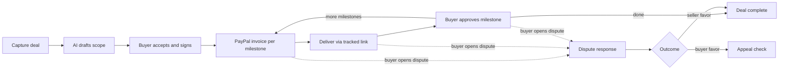

# PactPal product spec

**PactPal turns a deal made anywhere into a signed, timestamped record tied to a PayPal invoice, and turns that record into dispute evidence and an appeal check when a buyer challenges the payment.**

## The problem

People paid through PayPal for services and digital work keep losing disputes for the same reason: PayPal knows money moved, but not what was agreed, what was delivered, or whether the buyer accepted it. That lives in chats and emails, in forms PayPal does not accept, and it is assembled only after a dispute opens, under short deadlines. PactPal creates the evidence at the time of the deal, with the buyer's explicit agreement.

## Users

| User                                                                   | What they get                                                                                                                                                                                           |
| ---------------------------------------------------------------------- | ------------------------------------------------------------------------------------------------------------------------------------------------------------------------------------------------------- |
| **Seller** (primary): freelancer, artist, creator, small online seller | Clear scope, a signed agreement, PayPal invoices per milestone, tracked delivery and approvals, a ready evidence packet and deadline tracking when a dispute opens                                      |
| **Buyer** (secondary, advisory)                                        | A copy of what was agreed, pages to approve or request changes, answers about the agreement. No account needed: buyers use links, and can choose to sign in with PayPal from their link to keep access. |
| **AI agents and developers**                                           | An MCP server to read deals and prepare drafts; any sensitive action needs a human confirm token                                                                                                        |

## End-to-end flow

Every step writes events to the evidence ledger.

0. **Deal space (Phase 7).** Each deal is a shared space for its one seller and one buyer: a live chat, the scope, the timeline, files and the log. The steps below happen inside it.
1. **Capture.** The seller and buyer talk in the deal's live chat, and/or the seller pastes a chat or email thread, uploads files, forwards an email, or a platform webhook creates a draft deal. The raw source is stored and hashed.
2. **Scope.** AI drafts a structured scope with a citation to the source line for every field; anything without a source stays blank and is marked missing. Vague words are flagged with measurable rewrites. Subjective lines ("clean, modern look") must be tied to an approval step. The seller confirms.
3. **Agree.** The buyer gets a link to a single page with every key term, types their name and clicks "I agree and sign". The exact page is snapshotted; a receipt PDF with hashes goes to both sides.
4. **Pay.** One PayPal invoice per milestone, with the scope hash in the invoice note. The payment webhook links the PayPal transaction to the deal.
5. **Deliver.** The seller uploads each deliverable; the buyer opens it through a unique link. Views and downloads are logged with time, IP, device and file hash. The buyer approves or requests changes, which counts against the agreed revision limit.
6. **Dispute.** A PayPal webhook (or polling) brings in the dispute. PactPal matches it to the deal, shows the deadline and allowed actions, and builds an evidence packet from ledger events. The seller reviews and confirms; PactPal uploads it.
7. **Appeal.** If the decision goes against the seller, PactPal compares what was submitted (by hash) with what else the ledger holds. With genuinely new evidence it drafts an appeal; without, it says so plainly.

## Deal space (Phase 7)

One page per deal, shared by its seller and its buyer (the buyer through their emailed link, no account needed), with tabs:

| Tab      | What it holds                                                                                                                                                                                                                                                                                                                                                                             |
| -------- | ----------------------------------------------------------------------------------------------------------------------------------------------------------------------------------------------------------------------------------------------------------------------------------------------------------------------------------------------------------------------------------------- |
| Chat     | A live chat: messages arrive instantly, with typing, online and "seen" marks. Every message is saved with a fingerprint and the server's time in the evidence log, so the conversation itself is evidence (a pasted chat is only supporting material, because the seller supplied it). PactPal posts cards here too: "Scope v2 is ready for your review", "Changes requested", reminders. |
| Scope    | The seller asks the AI to draft the scope and timeline from the in-app chat, pasted chats, or both; later "Update from the latest chat" drafts the next version from the current one plus only the new messages, showing what changed. The seller edits and sends it for review; the buyer reviews it here and signs or asks for changes.                                                 |
| Timeline | Every agreed step in the agreed order: what the buyer provides (inspiration, content), reviews (the seller shares a sketch or blueprint, the buyer approves or asks for changes), payments (PayPal invoices), deliveries, anything else. Each step has who does it and an optional due date; both sides agree to it when the buyer signs. Progress and reminders follow it.               |
| Files    | Files both sides added, including pasted chats (also shown as text in the Chat tab, labelled "pasted by the seller")                                                                                                                                                                                                                                                                      |
| Log      | The evidence log with its fingerprint check                                                                                                                                                                                                                                                                                                                                               |

**The agreement loop.** Chat → seller asks for a draft → seller reviews and sends it → the buyer is notified (in the app, by email and in the chat) → the buyer signs, or asks for changes and negotiates in the chat (agreeing to some points and not others in their own words) → the seller asks the AI to update from the latest chat → v2 → the same review, until the buyer signs. Each version, review request, change request and signature is a logged event.

**The timeline.** Drafted by the AI from what the chat agreed, in whatever order it was agreed (for example: deposit, buyer sends references, sketch review, second payment, final delivery). Payment steps are the payment stages that become PayPal invoices, so invoicing, payment alerts, deliveries and disputes work as before. Every step's completion is a logged event: the buyer marks references provided (with files), the seller shares a sketch, the buyer approves it; payment steps complete when PayPal confirms payment and delivery steps when the buyer approves the delivery. Reminders go to whoever a step is waiting for, by email and in the chat, when it is due soon or overdue.

## AI roles

AI output is always a draft, stored apart from evidence, and every sentence or field cites a source line or ledger event id or stays blank. High-stakes tasks use the **council**: several models from different families answer, code validation drops answers with invalid citations, the rest are anonymized and ranked by every member, a Borda count picks one whole answer, and low agreement flags it for human review.

| Task                                                                                                                                                                      | When            | Engine                                   |
| ------------------------------------------------------------------------------------------------------------------------------------------------------------------------- | --------------- | ---------------------------------------- |
| Scope drafting from the conversation, with citations                                                                                                                      | Capture         | Council                                  |
| Timeline drafting: every agreed step, in the agreed order, each citing the chat (part of scope drafting)                                                                  | Capture         | Council (part of scope drafting)         |
| Updating a scope from new chat messages: the current version plus only the messages since the last draft                                                                  | Negotiation     | Council (part of scope drafting)         |
| Category check: what is actually being sold vs. the seller's chosen category                                                                                              | Capture         | Council (part of scope drafting)         |
| Vague-word detection and measurable rewrites                                                                                                                              | Capture         | Council (part of scope drafting)         |
| Pre-delivery check: does the file match the objective scope lines? Code checks format, size and transparency; a vision model checks content. Advisory to the seller only. | Before delivery | Single model (council optional)          |
| Message watcher: new buyer messages labelled within scope, extra revision or out of scope, with a drafted reply or change order                                           | During the deal | Single model                             |
| Buyer Q&A on the acceptance page, answered only from the agreement with citations; otherwise forwarded to the seller                                                      | Before signing  | Single model                             |
| Claim-vs-record: each statement in the buyer's claim matched to scope lines and ledger events, or marked "no record covers this"                                          | Dispute         | Council                                  |
| Neutral packet summary, every sentence tied to event ids                                                                                                                  | Dispute         | Council (from the claim-vs-record table) |
| Appeal statement explaining genuinely new evidence                                                                                                                        | Appeal          | Council                                  |

## Evidence ledger

An append-only, hash-chained log per deal (`packages/ledger`). Each entry stores the event type, actor (seller, buyer, system), payload, payload hash, previous entry hash, entry hash, server time and, where relevant, IP address and user agent. Editing, backdating or deleting any entry breaks the chain at that entry. Files are fingerprinted with SHA-256 and size.

Event types include: `MESSAGE_SENT`, `MESSAGES_READ`, `STEP_SUBMITTED`, `STEP_APPROVED`, `STEP_CHANGES_REQUESTED`, `STEP_DONE`, `REMINDER_SENT` (Phase 7), `DEAL_CREATED`, `BUYER_ADDED`, `SOURCE_ADDED`, `SCOPE_CONFIRMED`, `ACCEPTANCE_REQUESTED`, `ACCEPTANCE_WITHDRAWN`, `ACCEPTED`, `DECLINED`, `RECEIPT_SENT`, `COVERAGE_NOTICE_SHOWN`, `INVOICE_SENT`, `PAYMENT_RECEIVED`, `DELIVERY_SENT`, `DELIVERY_EMAILED`, `DELIVERY_VIEWED`, `DELIVERY_DOWNLOADED`, `MILESTONE_APPROVED`, `CHANGE_REQUESTED`, `CHANGE_ORDER_ACCEPTED`, `DISPUTE_OPENED`, `CLAIM_ANALYZED`, `PACKET_CONFIRMED`, `EVIDENCE_UPLOADED`, `DISPUTE_RESOLVED`, `APPEAL_SUBMITTED`.

## Evidence completeness score

A 0–100 measure of how complete a deal's records are, with "what is helping" and "what is missing and how to fix it". **Never a prediction of any outcome.**

| Item                                                                       | Points |
| -------------------------------------------------------------------------- | ------ |
| Scope confirmed with citations                                             | 10     |
| Exclusions listed                                                          | 8      |
| Checkable lines (objective or process; subjective lines tied to approvals) | 8      |
| Terms agreed in the deal's chat by both sides before signing (Phase 7)     | 4      |
| Buyer acceptance recorded, receipt sent                                    | 15     |
| Payment through a PayPal invoice                                           | 10     |
| Coverage notice shown                                                      | 3      |
| Delivery sent to the buyer's recorded email                                | 10     |
| Delivery access logged with file hash                                      | 12     |
| Milestone approvals                                                        | 8      |
| Delivery email matches the PayPal transaction email                        | 4      |
| Timeline steps recorded as they happened (Phase 7)                         | 4      |
| Retention settings in place                                                | 4      |

Built in 4h for the seller's deal page. Checkable lines are measured since 4i-2 (the seller marks each delivered line; earned in proportion to the lines marked), so PactPal measures 93 of the 100 points: the coverage notice and retention settings are listed as "not measured yet" and count 0 until they are built. The email item compares the PayPal invoice's address with the delivery email's address, because the paying account's email is not recorded.

## Evidence packet

1. Cover sheet: dispute id, deal id, parties, amount, dates
2. Claim-vs-record table
3. Neutral summary (trimmed for PayPal's notes field; full text in the packet)
4. Timeline from ledger events
5. Exhibits: agreement receipt, accepted scope, invoice and payment record, delivery log, approvals and change history, refunds if any, seller-supplied communications (marked as supporting material)
6. Hash manifest and ledger chain head
7. System description and a custodian statement template for a person to sign
8. Verification instructions

PDF or image files under 10 MB each, within PayPal's total size limit.

## Screens

| Screen                | Purpose                                                                                 |
| --------------------- | --------------------------------------------------------------------------------------- |
| Dashboard             | All deals, completeness score, next action, upcoming deadlines (AG Grid)                |
| Deal space            | One page per deal for both sides: Chat, Scope, Timeline, Files and Log tabs (Phase 7)   |
| New deal              | Paste, upload, forward address, or form                                                 |
| Scope editor          | Source and structured scope side by side with citations, flags, category check          |
| Buyer acceptance page | One screen, all key terms, typed name, "I agree and sign", Q&A                          |
| Deal timeline         | Ledger events with hashes and a verify button; milestone Gantt (Bryntum)                |
| Deliver               | Upload, pre-delivery check, delivery link, access log                                   |
| Buyer delivery page   | Preview or download, approve or request changes                                         |
| Dispute workspace     | Reason, countdown, allowed actions, claim-vs-record, packet preview, confirm and upload |
| Appeal workspace      | New evidence list, draft statement, countdown                                           |
| Council panel         | Each model's answer, the votes, the winner and the agreement level                      |
| Settings              | Connect PayPal, retention, disclaimers                                                  |

## PayPal integration

| API          | Used for                                                                                                                                                                                            |
| ------------ | --------------------------------------------------------------------------------------------------------------------------------------------------------------------------------------------------- |
| PayPal apps  | Each seller links their own sandbox PayPal app for invoices and disputes; "Connect with PayPal" (Partner Referrals) is not available to us: PayPal offers partner invoicing to select partners only |
| Invoicing v2 | Milestone invoices                                                                                                                                                                                  |
| Webhooks     | Payments and disputes, signature-verified                                                                                                                                                           |
| Disputes v1  | List, get, provide evidence, make offer, accept claim, appeal                                                                                                                                       |
| Orders v2    | Shipment tracking for physical goods                                                                                                                                                                |

Every operation tries a PayPal MCP tool first and falls back to REST; the transport used is shown in the timeline. See [sandbox-notes.md](sandbox-notes.md).

## MCP server for agents

Built in 8a–8c. The seller makes an agent key in the app and adds `https://<site>/mcp` (Streamable HTTP, the key as `Authorization: Bearer`) to an MCP client such as Claude Code, Claude Desktop or Cursor. The agent acts for that seller only.

| Tool                                            | What it does                                                                              |
| ----------------------------------------------- | ----------------------------------------------------------------------------------------- |
| `list_deals`, `get_deal`                        | The seller's deals: terms, timeline progress, evidence score, payment stages              |
| `list_disputes`, `get_dispute`                  | Disputes with reason, amount, deadline, what PayPal allows, evidence types, drafted notes |
| `create_deal_from_text`                         | A draft deal from pasted text (counted against the key's 30 a day)                        |
| `draft_evidence_packet`                         | Builds an evidence packet (logged); nothing goes to PayPal                                |
| `request_send_invoice`, `request_send_evidence` | Asks the seller; the request waits in the app with its exact wording                      |
| `confirm_action`                                | Runs an approved request with the seller's one-time code (10 minutes, once)               |
| `get_request`                                   | Where a request stands                                                                    |
| `lookup_listing`                                | Reads a product listing page through Channel3 (shown only; the seller adds it in the app) |

Sending an invoice or evidence needs the seller to approve the exact request on the deal page, which shows a one-time code to give the agent. There is no tool to sign, accept, act for a buyer, make offers, send messages or appeal. Read results tell the agent that buyers' words are data, never instructions. Every request, answer and action is in the evidence log with the key's last 4 characters.

## What's being sold (Channel3)

For goods and digital products (8e), the seller can paste the product's listing link on the Agreement tab. PactPal reads it through Channel3's URL lookup (`POST /v1/lookup`, one credit; pages outside Channel3's catalog are fetched live) and shows a card: title, brand, description, materials, features, attributes, weight and price, with up to 3 photos. Once the seller checks and uses it, the photos are saved as the deal's files (fingerprinted; Channel3 serves WebP, which PayPal does not take as evidence, so the packet leaves the photos out) and the facts join the agreement with their own fingerprint. The buyer signs them with the rest; they are in the signed receipt PDF (an exhibit in every evidence packet) and in the agreement lines the AI reads for buyers' questions and the claim-vs-record comparison ("Listed materials: …"). A change order cannot change them.

## Guardrails

1. Citations or blank; code validates every citation.
2. AI never creates evidence, timestamps, approvals or statements.
3. Pasted conversations are untrusted data: delimited, lines that give orders to an AI hidden from the models and never quotable, instructions inside ignored, outputs validated as JSON.
4. Human confirmation, with a diff view, before anything is sent to a buyer or to PayPal.
5. No outcome promises, no legal conclusions, never "legally binding" or "court proof".
6. A prompt-injection test set runs before each demo (`pnpm eval:injection --council`; `--models a,b` limits it to some models).
7. Draft quality is measured by `pnpm eval:scope`: each model alone and the council, scored against known right answers (wrong values counted separately).
8. Minimal personal data, stated retention, logging notice shown at acceptance.
